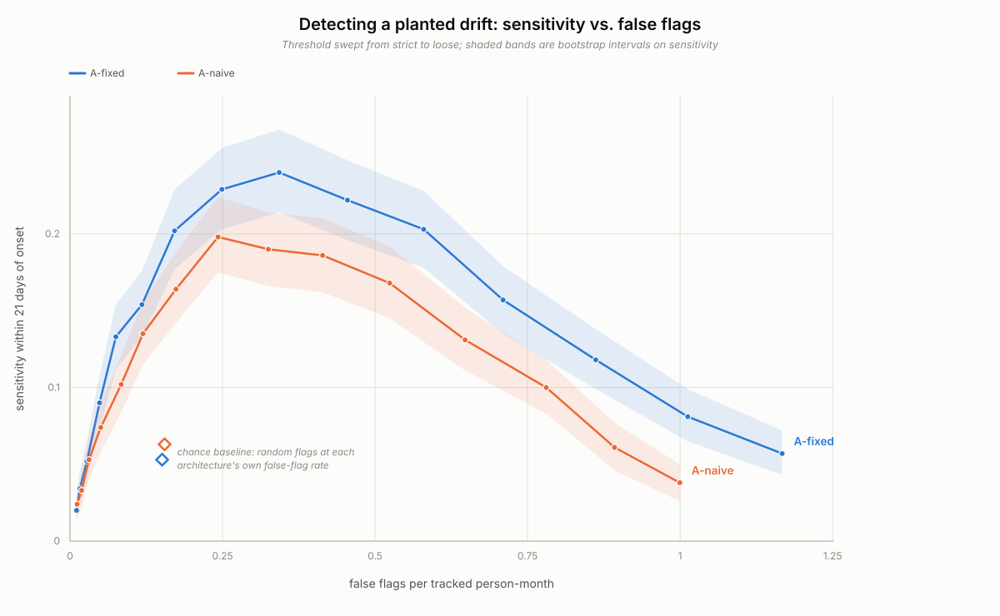

# Is it the person or the agent? Validity threats to inferring within-person change from agent conversation traces

Abhay Mettu

Manuscript draft v4, 2026-09-28. Author notes, provenance and open items are kept separately.

---

## Abstract

It is tempting to read a change in a score computed from a person's conversations with an AI agent as a
change in the person. I argue that this inference has not been validated, and I set out what validating
it would take. I lay out the interpretation as an argument-based validity argument with scoring,
generalization, extrapolation and use inferences, and place the threats specific to agents on it:
machine-authored text in the "user" stream, score-contingent agent help, silent agent and model version
changes, and criterion samples triggered by the score itself. A simulation, frozen and hashed before
scoring, tests these threats on eleven families of synthetic persons against eleven frozen predictions,
with every magnitude conditional on invented parameters. Two predictions hold. A criterion schedule
triggered by the change statistic attenuated the validity slope by 24.8 percent, about as much as
probing whenever the current score was high (25.4 percent), so it cannot be attributed to the trigger's
history; in this generator it plausibly reflects selection on the score together with per-person
scaling and centring. The frozen design could not have shown weighted recovery at 1,000 persons. Criterion non-response tied to the state added 12 to 16 percent slope bias, short of
the frozen threshold on the interval, and weighting on observables did not remove it. When the
agent-authored share rose with the state, one indicator's validity changed sign (from 0.34 to -0.01).
The best rule flagged 20 percent of planted drifts within 21 days at one false flag per six tracked
person-months, 3.7 times its chance level; P8, the one prediction proper that passed, compared it with a
criterion-only rule indistinguishable from chance. A second frozen simulation, of a sustained shift and
logged agent-behaviour changes, held one of two registered predictions; the other failed under its frozen
rule and is inconclusive under a post hoc interval reading. A metadata-only audit of one heavy-automation
user's coding-agent transcripts found that 0.93 percent of user-role entries were typed by the person.
The audit is n = 1 and descriptive. The contribution is the argument, the design requirements it implies
for a consented validation study, and an existence proof that the scoring inference can fail badly.

---

## 1. Introduction

A person who works with a general-purpose agent for a day leaves a long trace: what they asked for,
when, how long their messages were, how often they switched sessions, and what they left unfinished.
It is natural to ask whether that trace could register when the person's wellbeing and functioning move
away from their own usual range.

The closest work does one of three things. The first uses dialogue already about mental health. Tieleman et al. (2026) fine-tune a language model to estimate a questionnaire-scale
severity score from AI mental-health dialogue (final N = 3,953, held-out N = 842, r = .80). <!-- cite: -->
The second elicits answers: ALBA (Varadarajan et al., 2024) and MAQuA (Varadarajan et al., 2026) choose
questions adaptively, and Yun et al. (2024) vary the wording of a questionnaire an agent administers. The third classifies
conversations or people cross-sectionally. Anthropic (2025) classified 131,484 of 4.5 million sampled
conversations as affective (2.9 percent of use) with an aggregate clustering tool and stated that it had
no longitudinal data. Eichstaedt et al. (2018) predicted a chart-recorded condition from earlier
social-media language between persons (N = 683, AUC = 0.72). <!-- cite: -->
The OpenAI and MIT Media Lab study (2025) varied a voice product's features and measured self-reported
loneliness and emotional dependence over four weeks.

None of these asks whether a within-person change in a score computed from ordinary agent use is a
change in the person. The passive-sensing literature gives a reason to ask first: in GLOBEM, a
multi-year, multi-site phone-sensing dataset of more than 700 user-years, existing models did not
generalize across cohorts or years (Xu et al., 2022). Work on dense experience sampling shows that
within-person dynamics can carry information before a transition (Helmich et al., 2023), but it rests
on intensive self-report, not on a trace the person did not produce for measurement. My searches found
no study validating within-person change inferred from general-purpose assistant logs against a
repeated, independent criterion.

Agent traces make the validity question harder than it is for a phone sensor. The agent writes much of
what ends up in the "user" stream, its help changes what the person does next, and its software changes
under the person every few days. A score can move because any of those moved.

Section 2 lays out the validity argument and its agent-specific threats. Section 3 reports a
simulation of those threats, frozen and hashed before scoring. Section 4 audits the scoring inference on
my own agent transcripts, using metadata only; it measures contamination and estimates no state.
Section 5 turns the three into requirements for a consented validation study, section 6 states the
scope, and section 7 is the single translational paragraph. The paper builds no system or product
and makes no claim about any clinical condition.

---

## 2. The validity argument

### 2.1 Construct, interpretation and frame

**Construct.** A single latent, non-clinical state that the simulation labels wellbeing and
functioning, standardized within person, varying over days to weeks. Higher values are the direction of
concern: a rise lowers the probability of using the agent and of answering a criterion prompt and, in
one cell, raises the share of text the agent writes. The change statistic is one-sided and targets
rises; declines are out of scope.

**Interpretation under test.**

> A sustained rise in person i's trace-derived score above that person's own baseline indicates a rise
> in person i's state.

**Frame.** I use the argument-based approach (Kane, 2013): state the interpretation as a conjunctive
chain of inferences and collect backing for the least plausible assumptions. Validity is
a property of an interpretation of scores (Messick, 1995; AERA, APA and NCME, 2014), and Messick's two
named threats, construct-irrelevant variance and construct underrepresentation, organize most of what
follows. Borsboom et al. (2004) take a different position, that a score is valid for an attribute only
if variation in the attribute causes variation in the score. I use the argument-based structure to
organize the evidence and the causal condition to say what the scoring inference requires, without
claiming the two views agree. Four inferences carry the interpretation: scoring (section 2.2),
generalization (2.3), extrapolation (2.4, with its backing in 2.5), and use (2.6). Table 2 (section 2.7)
maps each to its threats, backing and evidence here.

### 2.2 Scoring: whose behaviour is this?

**Inference.** An indicator computed from the user side of the transcript summarizes the person's
behaviour.

**Threat.** Much of an agent transcript's user-role stream is not typed by the user: tool results,
harness and hook injections, prompts sent by automated processes, subagent traffic, and agent drafts
pasted back. Person-absent sessions also contaminate timing: an automated job at 3 a.m. adds late-night
activity no one performed. Machine text is
construct-irrelevant because its causal path to the indicator runs through delegation and automation
rather than through the behaviour the indicator is meant to reflect. When the state drives delegation,
that variance is partly state-caused, so correlational validity evidence cannot expose it.

For an indicator computed by daily averaging over entries, with a day's machine share `pi` independent
of the state and of the text values, the within-person validity is multiplied by

    Att = (1 - E pi) / sqrt(E[(1 - pi)^2] + E[pi^2] kappa + Var(pi) delta^2),

where `kappa` and `delta` are the machine-text variance ratio and mean gap in units of the human
indicator's SD (derivation in Appendix A). With Bernoulli mixing this is the zero-coupling case of the
contamination formula for AI-written survey responses (Mettu, 2026a), and at zero coupling it always
attenuates. If the machine share rises with the state, the mean gap couples to the state and adds or
removes validity that belongs to the delegation. A filter that catches 90 percent of machine text and
keeps 95 percent of human text leaves a residual share `pi' = 0.1 pi / (0.1 pi + 0.95 (1 - pi))`.

### 2.3 Generalization: from the observed days to the person's baseline

**Inference.** The person's baseline (here, a 28-day window) and the daily composite built against it
are dependable enough, over occasions and contexts, that a departure from the baseline is larger than
what the baseline's own sampling would produce.

**Threats.** The baseline is estimated from a few weeks of used days; if the state is already changing
inside it, the reference is wrong. The composite averages indicators whose number varies by day, because
days without use or without a usable indicator carry no score. And persons differ: the generator draws each
person's loadings separately, but section 3's validity statistics are pooled person-centred
coefficients, which can look acceptable while some persons' scores carry little information.
Associations across persons license nothing about change within a person unless strong conditions
hold (Molenaar, 2004; Hamaker, 2012; Curran and Bauer, 2011; Hamaker et al., 2015); within-person
structure can diverge widely from group structure (Fisher, Medaglia and Jeronimus, 2018), and whether a
group estimate transfers to individuals has to be checked rather than assumed (Adolf and Fried, 2019;
Hamaker, 2025).

### 2.4 Extrapolation: from a change in score to a change in the state

**Inference.** A sustained rise in the score reflects a rise in the state, rather than a change in the
agent, in the help it gives, in the mix of work, or in whether the person used the agent.

**Threats.**

- *Agent and model version.* A version change can move an indicator's mean and its loading. A logged
  change can be re-baselined; an unlogged one looks like drift.
- *Help.* The agent's help changes the person's next behaviour. In an earlier simulation in this
  program (Mettu, 2026b, Study 1a), personalized help left a shadow in the logs that raised internal
  consistency and fit while validity fell (in closed form; the simulation grid showed only a small
  fall), and a world with no person signal passed
  internal consistency, fit and convergent checks. Reliability evidence cannot stand in for validity
  evidence, as also seen when language-model questionnaire responses reached high internal consistency
  while failing invariance against human baselines (Shen and Han, 2026).
- *Context and non-state change.* An indicator's mean can differ between coding, writing and personal
  use, and the mix can shift; workload spikes, vacations, disengagement and broken logging can each move
  the score with no change in state.
- *Usage missingness.* If use depends on the state, unused days are missing not at random (Rubin,
  1976), and no analysis of used days alone removes the bias; it also weakens generalization (section
  2.3). An abstention rule trades coverage for protection.
- *Construct underrepresentation.* An agent trace samples only agent-mediated behaviour; a change that
  shows up elsewhere in a person's life is invisible to every rule here.

### 2.5 Backing for extrapolation: how the criterion is sampled

The score's relation to an independent criterion backs extrapolation; how that criterion is
sampled threatens the backing and is not an inference of its own.

**Criterion sampling.** If which days get a criterion depends on the score, the estimated validity is
biased. Selection on a variable related to the predictor changes the observed correlation (Pearson,
1903; Lawley, 1944); the range-restriction cases and corrections are standard in personnel selection
(Thorndike, 1949; typology in Sackett and Yang, 2000), restated recently as collider bias (Lamp and
MacKinnon, 2024). The closest structure is verification bias, corrected by weighting each verified case
by the inverse of its verification probability (Begg and Greenes, 1983), and outcome-dependent two-phase
designs use the same corrections (Zhou et al., 2002; Tao et al., 2021). In experience sampling, trigger
design changes which contexts get sampled (Lathia et al., 2013).

A schedule that asks for the criterion when a CUSUM is high selects on the score. As implemented in the
simulation, the CUSUM includes the day's composite, so the trigger selects on the current score as well
as on its history; section 3.9 compares it with a schedule that selects on the current score alone. A
trigger on the previous day's statistic would select on history only, which predicts the current state
beyond the current composite. A random floor with every occasion's selection
probability logged makes inverse-probability weighting possible; a trigger-only or fixed schedule does
not, because some days have zero probability of a criterion.

**Criterion non-response.** If the person answers less often when the state is higher, answered
occasions are missing not at random, and a response model built from observables cannot fully correct
it when response depends on the state beyond what the observables carry.

### 2.6 Use: the agent acting on the score

**Inference.** Acting on the score (changing how the agent helps, or asking for a criterion) does not
change the quantities the score is meant to reflect, or the change is known.

**Threat.** Score-contingent agent behaviour feeds back into the trace. When help is targeted on the
previous day's score, as in two of the simulation's cells, later indicators depend on earlier scores,
and the scoring and extrapolation inferences are then evaluated on data the rule itself shaped. A flag
or a criterion prompt could also change behaviour; the simulation fixes that reactivity at zero and says
nothing about it.

### 2.7 Summary

**Table 2. Inferences, threats and backing.** The last column maps each inference to the "links" of the
first draft of this argument.

| inference | main threats | backing needed | where in this paper | earlier link |
|---|---|---|---|---|
| scoring | machine-authored entries; person-absent sessions; state-driven delegation | entry-level provenance; machine share per indicator; naive vs filtered | section 4; section 3, P6 | link 1 |
| generalization | baseline error; drift inside the baseline; varying indicator count; heterogeneity across persons | baseline and change-score reliability; person-level validity distribution | section 3, P9, family BD; 3.8 | part of links 2 and 3 |
| extrapolation | version, help and context non-invariance; non-state change; usage missing not at random; construct underrepresentation | invariance across contexts, versions and help; false flags by non-state family; sensitivity; abstention | section 3, P1 to P3, P7, P10, `kappa` cell; 3.13, H3 | links 2 and 3 |
| backing for extrapolation | score-triggered criterion sampling; criterion non-response | random floor with logged propensities; weighted and unweighted estimates | section 3, P4, P5 | link 4 |
| use | score-contingent help; reactivity to flags and prompts | logged randomized help; logged prompts | section 3, targeted-help cells, P2 | not in the first draft |

*Figure 1.* The validity argument as a chain of scoring, generalization, extrapolation and use, with the threats placed on each. The backing for extrapolation, criterion
sampling and criterion non-response, is drawn inside extrapolation.

---

## Disclosures

**Preregistration.** Neither simulation was lodged with a registry. Each was frozen as a document in the
supplementary repository, committed and hashed before scoring: `sim/PREREG.md` for sections 3.2 to 3.11 (sha256
in section 3.1) and `sim/PREREG-003.md` for sections 3.12 and 3.13 (sha256 in section 3.12). A local commit is
not an external registration. The exploratory analyses of sections 3.10 and 3.11 follow plans committed and
hashed before they ran (two cells of 3.10 were computed once before its plan's commit); post-freeze changes are disclosed in sections 3.6, 3.11 and 3.12. [author to confirm: the
corpus audit of section 4 had no preregistration]

**Data, materials and code.** The simulation code, the frozen pre-scoring document, both scoring runs, the
spec 003 pre-registration, evaluation output and dated post-evaluation amendment (`sim/PREREG-003.md`,
`sim/results_003.json`, `sim/POST-EVALUATION-003.md`), the reporting-only metrics, the audit code and the
corpus audit's aggregate outputs are in the supplementary repository. None is yet at a persistent public
archive: the author has not yet authorised a deposit. [persistent link: to be added on deposit] The transcript
corpus itself is not shared, because it contains third-party content.

**Simulation reporting.** Sections 3.2 and 3.12 give each generator, its families and parameters; every
parameter is invented except indicator 4's mixing parameters (section 6, item 2). Sections 3.2 and 3.12 give the
persons per cell (1,000 and 4,000), sections 3.5 and 3.12 the person-bootstrap draws (2,000 and 1,000), and
sections 3.1 and 3.12 the evaluation seeds, each derived from its frozen file's hash; thresholds were tuned on a
separate tuning seed (section 3.3). The code and the hashes of every frozen file are in the repository.

**Ethics.** The data in section 3 are synthetic. Section 4 audits the author's own agent transcripts; no
participants were recruited. User-role text was read only in memory, to assign authorship classes; only
metadata and aggregates were stored; no state of any person was estimated. The stream contains some
third-party content (0.77 percent of tool results came from tools named for messaging, calendar or email).
The audit code parses user-role text and walks tool-result content in memory to count characters and assign authorship classes; it does not establish whose words every payload contains, so no claim is made that no other person's content was read. [AUTHOR TO CONFIRM: no ethics review was sought, because the only human data are the author's own
usage metadata; third-party traffic was counted by tool name, and the parse does not establish whose words each payload contains.]

---

## 3. Simulation, frozen and hashed before scoring

### 3.1 Status

The design, metrics and predictions were frozen before scoring as a committed file with sha256
`60db6dd195942387e5572a640224c4cb13836f29c37c1b611b14c70598678f17` (supplementary repository,
`sim/PREREG.md`), at 21:21 CDT on 2026-09-27. Every evaluation seed in sections 3.2 to 3.11 derives from that hash; sections
3.12 and 3.13 report a second, separately frozen specification (spec 003), with its own hash and seed, given
in 3.12. The
freeze is a local commit, not an external registration. The design was written for a change-detection
layer; seven minutes after the freeze, the project's direction was recorded as a measurement-validity
study, and the simulation is read here as validity evidence. That reframing changed nothing in the frozen
text. The scoring rules are candidates under test, not products, and the probe schedules are
criterion-sampling designs for a future validation study. Everything here is synthetic and conditional
on the invented parameters listed in section 6.

### 3.2 Generator

Each synthetic person has 140 days (days 1 to 28 are baseline), with 1,000 persons per family per
cell; all rules run on the same persons. The state
`D_t` is AR(1) with `phi_D = 0.7` and marginal SD 1; drift families add a ramp of +1.0 SD from an onset in
days 50 to 100, over 7 to 21 days. Workload and a daily context (code, write, personal) vary alongside
it; a day is used with probability `expit(logit(0.8) - kappa D_t)`, less on vacation or disengagement. Six indicators are observed on used days (late-activity share, session fragmentation, deferral
rate, message length, negative self-reference, reply latency), each `H_jt = lam_j D_t + gam_j L_t +
beta_j[ctx_t] - A_t psi_j (1 + theta1 D_t) + e_jt`, with per-person loadings `lam_j ~ U[0.25, 0.5]`.

Indicators 4 and 5 are mixed with machine text by daily averaging, `X_jt = (1 - pi_t) H_jt + pi_t M_jt`,
with `M` independent of `D`. For indicator 4 the generator takes `pi_bar = 0.845`, `kappa = 0.547` and
`delta = 0.274` from the corpus audit; the share is a day mean, but `kappa` and `delta` were computed over
entries and used as day-level parameters (section 3.9 gives the consequence). Help is logged, with probability
0.3 by default; a version change shifts indicators 2 and 6 by +0.5 and scales their loading by 0.7. The criterion `Y_t = D_t + e_Y` has
reliability 0.7, and the probability of answering falls with `D` at rate `m1`.

**Families.** S (stable), DR (drift), VA (vacation), SP (workload sprint), BI (broken integration), AV
(version change, logged for half), DE (disengagement), DV (drift overlapping a vacation), CS (context
shift), BD (drift beginning inside the baseline) and AV2 (unlogged version change on indicators 1 and
4); the fixed rule was not designed for CS, BD or AV2.

**Cells.** A default cell plus one-at-a-time variations: `kappa = 0.3`; `m1 = 0.5`; `m1 = 1.5`;
help targeted on the previous day's composite; targeted help whose effect grows with the state
(`theta1 = 0.5`); Bernoulli mixing; and a machine share that rises with `D` (logit slope 0.5). The
rising-share cell is hypothetical: it models delegation of drafts, which the audit did not measure.

### 3.3 Candidate scoring rules

Every rule averages within-person z-scores of the available indicators into a daily composite `C_t` and
runs a one-sided CUSUM, `S_t = max(0, S_{t-1} + C_t - k)` with `k = 0.5` (Page, 1954), with a reset and a
14-day refractory period after a flag and `S` held on days with no usable indicator. The threshold `h` is
tuned per rule on family S, on a separate tuning seed, to one false flag per six tracked person-months.

- `pop`: population rather than personal z-scores.
- `A-naive`: personal baseline, all indicators on every used day, all user-role text in indicators 4
  and 5, no workload term, no reset, no abstention.
- `A-fixed`: `A-naive` plus (i) indicators 2 and 3 on unhelped days only, following an earlier result in
  this program that unhelped-day scoring holds under state-dependent help (Mettu, 2026b, Study 5); (ii)
  indicators 4 and 5 from text an authorship filter labels human (sensitivity 0.9, specificity 0.95);
  (iii) timing and friction indicators residualized on observed workload; (iv) reset and a 14-day
  re-baseline at a logged version change; (v) abstention when 14-day usage falls below 40 percent of the
  baseline rate. Ablations remove each component in turn.
- `probe-only`: a CUSUM on criterion answers alone, z-scored on a four-probe baseline block, random
  schedule, matched budget.

No rule adjusts for context. Tuned thresholds (`sim/tuning.json`):
`h` = 1.125 (`pop`), 1.739 (`A-naive`), 3.334 (`A-fixed`) and 22.949 (`probe-only`, after the
post-freeze re-tune in section 3.6).

### 3.4 Criterion-sampling designs

Each design except `none` has a fixed baseline block of four criterion occasions (days 7, 14, 21 and 28)
and a budget target of 3.0 occasions per person-month after the baseline: `none`; `fixed`, every 10
days; `random`, each day with probability 0.1; `triggered`, with probability 1.0 on days when `S` lies in
[h/2, h); `mixed`, a random floor of 0.04 per day plus probability 0.795 in the same band; and `current`,
a construction check that probes when `C_t` exceeds 0.956. The triggered design reaches only 2.265 per
person-month. Selection probabilities are logged; weighting is identified only for `random` and `mixed`. A flag counts as confirmed if a criterion occasion within
the next 7 days reads at least 0.5 above the person's baseline-block mean.

### 3.5 Decision rule

A prediction holds only if its 95 percent Monte Carlo interval lies beyond its frozen threshold (or, for
a "within X" clause, inside plus or minus X), in the default cell unless another is named. Intervals come
from a 2,000-draw person bootstrap, paired within a panel and independent across panels. A failed
prediction is reported as failed, and nothing is re-tuned after scoring. The frozen text's
standard-error formula divides by the square root of 200, a leftover from an earlier design; the
literal reading would change neither verdict that holds. Table 1 gives the eleven predictions and their
thresholds. P1, P1b, P2 and P3 are construction checks, which test whether each component of `A-fixed` does what it was built to do; they
are not findings.

### 3.6 Scoring runs and post-freeze fixes

Run 1 was scored first, at the freeze. A separate audit of the scoring code against the frozen text, run
by an AI agent within the same project, found that run 1 decided every prediction on point estimates
rather than on the interval rule and departed from the frozen text in four places: P1b's denominator
(tracked instead of total person-months); P4's probe window, all-days reference and weighted
correlation; P5's reference slope, which was conditioned on response; and P8's criterion-only rule,
z-scored on about 22 baseline-window answers its schedule never administers instead of the four-probe
block. Run 1 is kept, superseded; run 2, committed 43 minutes after the freeze, applies only those fixes. The P8 fix changes the criterion-only threshold, so the frozen tuning procedure
was re-run on the corrected code and the tuning seed, moving its `h` from 6.539 to 22.949; no
evaluation-seed number was used. Run 1's P8 was 17.3 points [14.7, 19.8] and 7.12 days [6.34, 7.91];
run 2's is in Table 1. Every verdict the fixes changed went from PASS to FAIL (P6 and P10). Where the
frozen text allows two readings, the verdict uses the as-run reading, fixed before scoring, and the
alternative is reported beside it; for trigger timing the alternative is the more natural one for a real
study and gets equal weight in section 3.9.

### 3.7 Results

Only P1b and P8 hold. The other nine fail, including three of the four construction checks.

**Table 1. Predictions, score run 2.** Point [95% Monte Carlo interval], 1,000 persons per family per
cell; "cc", construction check. Alternatives: G2, pooled false-flag rate; G3, a pre-onset flag does not
cancel a later detection; P4, previous day's statistic; P6, validity scale. Precision: "clear miss",
interval wholly on the wrong side; "undecided", interval straddles the threshold; "not decidable", a
"within X" interval wider than 2X; "opposite", interval wholly beyond the predicted direction.

| | statistic | threshold | run 2 | verdict | precision | alternative reading |
|---|---|---|---|---|---|---|
| P1 (cc) | SP false flags, A-naive / A-fixed | >= 2 | 1.23 [1.13, 1.35] | FAIL | clear miss | G2: 1.23 [1.13, 1.35] |
| | VA / DE / BI, same ratio | in [0.5, 2] | 1.03 [0.92, 1.16] / 1.00 [0.89, 1.14] / 0.80 [0.72, 0.87] | holds | holds | G2: 1.03 / 0.99 / 0.80 |
| P1b (cc) | DE / S false flags per total person-month | <= 1.5 | 0.60 [0.50, 0.73] | PASS | holds | none |
| P2 (cc) | DR sensitivity, A-fixed minus A-naive, targeted state-dependent help (points) | >= 10 | 9.2 [6.7, 11.9] | FAIL | undecided | G3: 12.4 [9.6, 15.2] |
| | margin by which removing (i) exceeds half the gap | >= 0 | 0.007 [-0.009, 0.022] | fails | undecided | G3: 0.023 [0.007, 0.039] |
| P3 (cc) | logged AV false flags, without (iv) / with | >= 2 | 1.85 [1.66, 2.06] | FAIL | undecided | G2: 1.85 [1.67, 2.07] |
| | AV2 / S false flags, A-fixed | >= 2 | 1.75 [1.50, 2.03] | fails | undecided | G2: 1.76 [1.51, 2.04] |
| P4 | triggered: correlation deflation | >= 0.05 | 0.104 [0.076, 0.133] | holds | holds | 0.049 [0.021, 0.077] |
| | triggered: relative slope attenuation | >= 10% | 24.8% [18.5, 31.3] | holds | holds | 16.1% [10.0, 22.1] |
| | mixed, weighted slope minus all-days | within 0.03 | -0.055 [-0.124, 0.018] | FAIL | not decidable | 0.067 [0.001, 0.132] |
| | mixed, weighted correlation minus all-days | within 0.03 | -0.014 [-0.048, 0.020] | fails | not decidable | 0.016 [-0.015, 0.046] |
| P5 | relative slope bias, `m1 = 0.5`, random | within 5% | -0.8% [-5.7, 3.9] | FAIL | undecided | none |
| | added bias at `m1 = 1.5` over `m1 = 0`: fixed / random / triggered / mixed | >= 10% each | 13.1% [6.9, 18.2] / 13.5% [7.0, 17.5] / 15.5% [6.1, 24.6] / 12.2% [5.3, 18.8] | fails | undecided | none |
| | share of bias removed by response-propensity weighting | < 0.5 | -0.107 [-0.231, -0.011] | holds | holds | lags 1 to 3: -0.103; added bias only: -0.114 |
| P6 | indicator 4, simulated minus formula attenuation, unfiltered / filtered | within 0.03 | 0.023 [0.002, 0.046] / 0.013 [-0.002, 0.029] | FAIL / holds | undecided / holds | |
| | indicator 5, same, unfiltered / filtered | within 0.03 | 0.011 [-0.027, 0.054] / 0.002 [-0.021, 0.024] | fails / holds | not decidable / holds | |
| | Bernoulli cell, indicator 4 / indicator 5 | within 0.03 | -0.019 [-0.046, 0.006] / -0.003 [-0.025, 0.018] | fails / holds | undecided / holds | |
| | rising share, indicator 4, simulated minus formula | >= 0.05 | 0.151 [0.119, 0.192] | holds | holds | validity scale: 0.043 [0.037, 0.049] |
| P7 | DR minus DV sensitivity, A-fixed (points) | >= 15 | 11.0 [8.0, 14.1] | FAIL | clear miss | G3: 14.7 [11.3, 18.1] |
| P8 | DR sensitivity, A-fixed minus probe-only (points) | >= 10 | 17.8 [15.2, 20.4] | PASS | holds | G3: 23.7 [20.9, 26.5] |
| | restricted mean time to flag, probe-only minus A-fixed (days) | >= 3 | 7.73 [6.94, 8.49] | holds | holds | G3: 9.98 [9.11, 10.77] |
| P9 | BD sensitivity minus half of DR sensitivity | <= 0 | 0.174 [0.144, 0.203] | FAIL | opposite | G3: 0.142 [0.112, 0.173] |
| P10 | CS / S false flags, A-fixed | >= 1.5 | 1.71 [1.48, 1.99] | FAIL | undecided | none |

A prediction fails if any part fails; every alternative reading gives the same verdict. P1's SP
ablation ratio is 1.047, so the workload component did not account for the SP difference. P5's "under 5 percent" is scored as the interval lying inside plus or
minus 5 percent. In the Bernoulli cell the filtered and unfiltered indicator 4 coincide because the
residual share `pi'` equals `pi` when `pi` is 0 or 1.

### 3.8 Frozen metrics not used by any prediction

The frozen design also lists metrics that no prediction scores. They were computed from the run 2 panels
after scoring, as reporting only, with no thresholds.

**Sensitivity against false flags** (Figure 2). A-fixed's sensitivity peaks at 0.240 [0.214, 0.268] at `h` =
2.128 (0.343 false flags per tracked person-month) and falls on both sides: to 0.057 at `h` = 0.667
(1.167 false flags) and 0.020 at `h` = 10.002 (0.011). A-naive peaks at 0.198 [0.175, 0.224]. The fall at
loose thresholds is expected from the as-run sensitivity rule, under which a flag before onset makes the
person a miss even when a later flag falls inside the window; under the alternative reading (G3) that
reason disappears, but the curve was not computed under it.

*Figure 2.* Sensitivity within 21 days of onset (family DR) against false flags per tracked
person-month (family S) as the threshold is swept, for A-fixed and A-naive, with 95 percent bands;
points mark each rule's chance baseline at its realized false-flag rate.

**Chance baselines.** For each rule, random flags at the rule's own realized false-flag rate on S, placed
on DR's tracked days and scored with the same pre-onset exclusion and tracked-day definition as the
observed sensitivity, give a chance sensitivity. A-fixed's 0.197 is 3.7 times its chance level of 0.053
[0.039, 0.067]; A-naive's 0.154 is 2.4 times 0.063; `pop`'s 0.180 is 2.3 times 0.077; the ablations are
1.8 to 3.1 times theirs. Probe-only's 0.019 [0.011, 0.028] is against a chance level of 0.015 [0.008,
0.023].

**Realized false flags.** On family S of the evaluation seed, per tracked person-month: A-fixed 0.151
[0.132, 0.169], A-naive 0.155, `pop` 0.162 and probe-only 0.179 [0.115, 0.250], against a tuning target of
0.167. The interquartile range of person-level rates is 0.323 for A-fixed and 0 for probe-only: at least
three quarters of persons had no false flag under probe-only. Its rate per total person-month, 0.014, is
about 8 percent of its tracked rate, so it is tracked on few days.

**Person-level validity.** Because pooled coefficients can hide persons whose scores carry little
information (section 2.3; Fisher, Medaglia and Jeronimus, 2018), the distribution is reported. Across
persons, the within-person correlation of A-fixed's composite with
the state on tracked days averaged 0.565 [0.560, 0.571] on S (5th to 95th percentile 0.410 to 0.695) and
0.596 on DR, and no person's was at or below zero. For the raw message-length and negative
self-reference indicators it was at or below zero for 18.8 to 21.5 percent of persons across S and DR;
after filtering, for 0.4 to 0.8 percent.

**Usage depending on the state.** At `kappa = 0.3`, A-fixed's DR sensitivity was 0.168 [0.145, 0.190]
against 0.197 at `kappa = 0`, and abstention rose from 0.199 to 0.232, almost all from unused days.

**Other metrics.** `pop` reached a DR sensitivity of 0.180 [0.157, 0.204]. The confirmation rule's
positive predictive value on DR was 0.195 to 0.226 across schedules, and the median time to flag was 14
days [13, 15]. Under `triggered` the realized budget was 1.50 per person-month on S and 3.23 on DR. The
frozen reset cost cannot be computed: no frozen family has both a drift onset and a version change.

### 3.9 What the results show

Some results follow from the generator's structure: selection attenuation when the criterion schedule
depends on the score; weighting on observables not removing state-dependent non-response; and
the sign of state-coupled contamination, which follows from `X = H + pi (M - H)`. They are expected
whenever `phi_D > 0`, the trigger depends on the score, the loadings are non-zero, and the coupling and
mean gap are non-zero; on an exploratory grid (section 3.10) the direction held on point estimates
everywhere, but three expectations failed their interval rule in named cells. The magnitudes (0.197,
17.8 points, 24.8 percent) are set by invented values.

**Which mechanisms appeared.** Selection attenuation, state-coupled authorship distortion and the
non-state false-flag sources appeared; the workload component (SP ablation ratio 1.047) and component
(i) did not do their jobs, and P9 went the opposite way.

**Criterion sampling (P4)** (Figure 3, left). The triggered slope was 0.700 [0.640, 0.759] against an all-days slope of
0.930, an attenuation of 24.8 percent [18.5, 31.3], with the correlation deflated by 0.104 [0.076,
0.133]. The `current` control, probing whenever today's composite exceeds a fixed cut, gave a slope of 0.694 [0.588, 0.802], an attenuation of 25.4 percent [14.1, 36.7], and a
correlation deflation of 0.281 [0.254, 0.309]. Selecting on the current score alone produces the same
slope attenuation, so the 24.8 percent should not be attributed to the trigger's history. Direct
selection on the predictor leaves the slope unbiased in a homogeneous linear-Gaussian model (the frozen
check with a common loading and population scaling moved it by about 6 percent); here it plausibly
combines with per-person loadings, scaling and person-centring on the selected days. With the previous day's
statistic in the trigger, the attenuation was 16.1 percent [10.0, 22.1]; that reading is closer to
selection on history, but the estimator effect seen in `current` has not been separated from it.
Weighted recovery could not be shown under either reading (-0.055 [-0.124, 0.018] with today's
statistic; an overshoot of 0.067 [0.001, 0.132] with the previous day's); an interval about 0.14 wide
cannot fit a band 0.06 wide. The correlation deflation is the classical range-restriction result (Thorndike, 1949;
Sackett and Yang, 2000), structurally the verification bias of Begg and Greenes (1983), shown here in
the agent-probing setting. The slope attenuation is not that result: direct selection leaves the slope
unbiased in a homogeneous model, so it plausibly reflects the estimator, as above. The history-conditional weighting from
micro-randomized trials (Boruvka et al., 2018) applies, but at N = 1,000 its interval is too wide to show
recovery.

**Criterion non-response (P5).** At `m1 = 1.5`, the total relative slope bias was -15.3 percent [-20.0,
-10.7] (fixed), -14.3 percent [-18.8, -9.8] (random), -40.3 percent [-47.8, -33.1] (triggered) and -18.3
percent [-23.6, -13.1] (mixed). The triggered total includes the 24.8 percent selection attenuation that
the same schedule shows at `m1 = 0`; the added bias is in Table 1. A response-propensity weight fitted on
the current composite, a lagged composite and day of week did not remove it, in a generator where
response depends on the state by construction.

**Authorship (P6).** The contamination formula tracks the simulated attenuation in expectation (largest
point difference 0.023), but three of the six comparisons in Table 1 fall outside plus or minus 0.03 on
the interval. The hypothetical rising-share cell gives the largest distortion the simulation found (Figure 3,
right). Message length's attenuation factor exceeded the formula by 0.151 [0.119, 0.192]: validity
supplied by delegation rather than by behaviour. For negative self-reference, whose machine-text mean
sits below the human mean, the within-person validity was -0.011 [-0.016, -0.005] against 0.340 [0.334,
0.346] for the unmixed indicator, so its sign changed; filtering restored the sign but not the size
(0.138 [0.131, 0.146]). This is not a frozen prediction, since P6's rising-share clause names indicator 4
only, and it follows from an invented machine-text mean (-1.0 SD) and an invented coupling slope (0.5).

Indicator 4 ran at the audit's entry-level variance ratio and mean gap. Analytically, the formula gives
an attenuation of 0.235 at those values (0.802 after filtering) and 0.527 at the corpus's day-level
values (0.929 after filtering), which match the generator's daily averaging; the frozen simulation thus
used the values that imply more attenuation, and it was not re-run.

**Drift inside the baseline (P9).** BD was flagged more often in days 29 to 49 (0.272) than DR within 21
days of onset (0.197), the opposite of the prediction. One unchecked candidate: a BD onset in days 10 to
25 with a 7 to 21 day ramp can still be rising after day 28, against a baseline that absorbed only part
of it; the pre-onset rule also applies only to the DR side.

**P8.** P8's pass is a win over a criterion-only comparator indistinguishable from chance (0.019
[0.011, 0.028] against 0.015 [0.008, 0.023]), whose false-flag matching held per tracked person-month
(0.179 against 0.151) but not per total person-month (0.014 against 0.121): a property of the frozen
four-probe scaling, not evidence that passive scoring beats asking.

*Figure 3.* Left: person-centred slope and correlation of criterion on composite (family S), on all
days and on days sampled by the triggered, `current` and weighted mixed schedules, with 95 percent
intervals. Right: attenuation factor predicted by the formula and simulated when the
agent-written share rises with the state (hypothetical cell), for indicators 4 and 5, raw and filtered;
indicator 5 raw is simulated at -0.08 against a predicted 0.29. The -0.08 is a mean of per-person
attenuation ratios; the -0.011 in the text is a different estimator, the person-averaged within-person
correlation of the indicator with the state.

### 3.10 Exploratory robustness (not frozen)

An exploratory grid varied one parameter at a time around the frozen default, in 11 cells of 1,000
persons: the loading range ([0.10, 0.25] and [0.50, 0.80]), `phi_D` (0.3 and 0.9), the help effect (0.25
and 1.0), day-level indicator-4 contamination, the rising-share slope (0.25 and 1.0), and `m1 = 1.5`. The
plan, its six expectations and its success rule (a 95 percent interval excluding the null in every
cell) were committed and hashed before the run (supplementary repository, `sim/ROBUSTNESS-PLAN.md`);
two cells were computed once before that commit, for a refactor check. `h` was re-tuned per cell and the
schedule parameters were not. The grid changes no verdict in Table 1.

Under the plan's pre-stated rule, three of the six expectations held in every cell (S3, S5, S6), and
three failed the pre-stated rule in named cells (S1, S2, S4; bullets below). The grid's default cell uses a re-tuned A-fixed threshold
(`h` = 3.209, against 3.334 in the frozen tuning) and different seeds, so its magnitudes (for example a
triggered slope ratio of 0.829 [0.770, 0.890]) are not comparable with Table 1.

- Held: passive rules beat their own chance baselines, state-dependent non-response added bias that
  propensity weighting did not remove (tested at `m1 = 1.5` only: added bias 0.162 [0.091, 0.207]), and
  the context shift raised false flags (CS over S ratio 1.43 to 1.93), in every cell tested.
- S1 failed in one cell. The triggered schedule's probed-day slope was below the all-days slope in
  every cell (ratio 0.550 to 0.893); the `current` control's interval crossed 1 in the low-loading cell
  (0.885 [0.622, 1.176]).
- S2 failed in three cells. Its direction held in all 11 cells on point estimates (positive for
  indicator 4, negative for indicator 5), but indicator 4's interval crossed zero in the low-loading,
  high-persistence and strong-coupling cells, where its standard error was 5 to 16 times the default's.
  Read as precision rather than a sign reversal, this still means the grid says little about indicator 4
  in those cells. The indicator-5 value in the low-loading cell, -2.707 [-6.264, -0.707], is not
  interpretable: the simulated attenuation ratio divides by the unmixed indicator's within-person
  validity, which is small at weak loadings.
- S4 failed in one cell. It expected probe-only to be indistinguishable from chance; at `m1 = 1.5`
  probe-only fell just below its chance baseline (-0.010 [-0.019, -0.001]), a single marginal exclusion
  in 1 of 11 cells, which chance alone can produce. The below-chance direction was not anticipated, and
  attributing it to non-response concentrating when the state is elevated is a post hoc conjecture. In
  the other ten cells, an interval containing zero is not evidence of equivalence.
### 3.11 Exploratory sensitivity: the baseline series for indicators 4 and 5 (not frozen)

A-fixed's component (ii) scores indicators 4 and 5 from the authorship-filtered text, but the per-person
baseline mean and standard deviation that those two indicators are standardized against were fit on the
unfiltered text, in the frozen code and in every run above. The frozen text did not say which series the
baseline uses, and the mismatch was found after scoring, while reading the code (supplementary repository,
spec section 18.1). On the attribution round's panels, not the frozen seeds, it offsets the composite's level
(an S mean of about +0.14 as run against +0.03 with a matched baseline) and inflates the scale of the two
z-scores by about 1.2; because `h` was tuned with both, the frozen false-flag rate is unaffected. A post-freeze
sensitivity analysis, planned and hashed before it ran (`sim/SENS-BASELINE-PLAN.md`), re-scored the frozen
evaluation seeds with the baseline fit on the filtered series and every threshold and schedule re-tuned by the
frozen procedure. None of the 14 primary verdicts in Table 1, and no component boolean, changed. Detection
point estimates were lower (A-fixed's 21-day DR sensitivity 0.176 against 0.197; P8's gap 15.7 [13.3, 18.2]
against 17.8 [15.2, 20.4] points), with overlapping separate intervals and no paired interval computed, so the
drop is not established. With the frozen thresholds kept instead of re-tuned, five verdicts change and
A-fixed's false-flag rate falls to 0.072 per tracked person-month against 0.151 as run, which the plan's
reading rule classes as an operating-point effect. The frozen verdicts stand; the as-run baseline is a
disclosed choice, not a fix, and the matched baseline is the one a future scorer should use.

### 3.12 Spec 003: a sustained shift and logged observer changes

Spec 003 keeps the generator of section 3.2 and A-fixed (`k = 0.5`), with help off, a 210-day record and a 28-day
baseline. In families DR-1.0 and DR-1.5, `D` ramps to a mean 1.0 or 1.5 SD higher from an onset drawn uniformly on
days 70 to 120, and stays there. An alarm (a flag, section 3.3) on day `a` is confirmed if probes on `a + L`, `a +
2L` and `a + 3L` (`L` = 3, 9 and 29 at `phi_D` 0.3, 0.7 and 0.9) average at least 0.5 above four baseline probes;
the comparators are next-day probes and, in simulation only, an oracle reference free of baseline error in `D`.
The probe rule `wait` probes a later alarm only after the last probed alarm's third probe day; `all` probes every
alarm, and `stop` none after a first confirmation; the budget target is 3.0 probes per tracked person-month. In
the PS families the agent's own behaviour changes on a day in the same window, logged for half of persons with the
indicators it can touch: PS-sub raises indicators 1, 2 and 6, PS-use also adds check-ins, PS-prop shifts in
proportion to each person's loadings, and DR+PS adds PS-use's change to DR-1.0 near onset. Rule L0 ignores the
log; L1 resets `S`, holds it and re-baselines every indicator over 14 days; L2 re-baselines only the logged
indicators; M1 attributes an alarm from the indicator pattern alone.

Two registered predictions (H2a, H3) and four construction checks (H1a, H1b, H4, H5) were frozen in
`sim/PREREG-003.md` (supplementary repository) at commit `57208bc`, 12:27 CDT on 2026-10-07, sha256
`06ee47576d02bc440560115b07aad029e8c7574480b684b4c7779d796c99bb79`, a local commit, and scored once (attested by
the run log; the frozen scorer did not enforce it) at N = 4,000 persons per cell, with 1,000 bootstrap resamples
and a seed (192815961) derived from the frozen file's hash. Choices made after the design run are disclosed there:
H3's point rule for L1 and L2, chosen knowing it passed on the design draw (1.421) where the interval rule did not
([1.175, 1.706]), while the only other draw gave 1.629, above 1.5; H1b's 0.70, just under the design lower bound
(0.715); H2b's demotion to exploratory; a 21-day re-baseline window, evaluated and not taken; the budget rule; and
N, raised from 2,000.

A blocking design review by a separate AI agent was complete at 10:44 CDT, before the freeze, but the freezing
lane (the agent session that froze the file) had not read it, and its blocking items, among them an objection to
H3's point rule, were not applied. A dated amendment written after the evaluation (`sim/POST-EVALUATION-003.md`)
discloses the review and adds post hoc readings and nine definition corrections, one of which retires the frozen
phrase "non-refractory tracked days"; it changes no frozen verdict, threshold or number.

### 3.13 Results, spec 003: a sustained shift in `D`

Under the frozen rules, one of the two registered predictions holds (H2a: 0.202 [0.175, 0.227] against 0.10, design value 0.201) and H3 fails, on one of its six clauses.
All four construction checks hold. A post hoc interval reading of H3, adopted after the evaluation, is reported
second, in the H3 paragraph.

**Table 3. Predictions, spec 003 evaluation run.** Point [95% person-bootstrap interval], 4,000 persons per cell;
"cc", construction check. S, stationary `D` with no observer change; DR-1.0, a ramp in `D`; PS-sub, PS-use and
PS-prop, stationary `D` with an observer change logged for half of each family's persons (PS-use also raises the
agent's check-ins; PS-prop's change is proportional to each person's loadings). H3 uses the logged persons of
PS-sub and PS-use, H5 the unlogged persons of PS-prop. H3's rate, for each rule and family, is the logged persons'
alarms per 30 tracked days from the later of the change day and the end of the 28-day baseline to day 210, pooled
over persons (total alarms over total tracked days), divided by the same persons' pooled rate on the S panel over
the same window. A tracked day is one on which the detector neither abstains nor holds: days in the 14-day
refractory period count as tracked (the frozen text's "non-refractory" misdescribes the scorer that produced the
verdicts), and L1's 14 hold days after the change do not. Verdicts compare the stored 4-decimal values with the
thresholds. A prediction fails if any clause fails.

| | statistic | threshold | est [95% interval] | verdict |
|---|---|---|---|---|
| H1a (cc) | S, `phi_D` 0.7: confirmed share, spaced minus next-day | interval at or below -0.15 | -0.2643 [-0.2956, -0.2345] | PASS |
| H1b (cc) | DR-1.0, `phi_D` 0.7: spaced over next-day confirmed share, first in-window alarm (persons in the Notes) | interval at or above 0.70 | 0.8871 [0.8398, 0.9403] | PASS |
| H2a | S, `phi_D` 0.9: spaced confirmed share minus oracle-reference share | interval at or above 0.10 | 0.2019 [0.1748, 0.2267] | PASS |
| H3 | logged-person alarm rate over S, all six clauses | all six hold | | FAIL |
| | L1, PS-sub | point below 1.5 | 1.5756 [1.4205, 1.7489] | fails |
| | L1, PS-use | point below 1.5 | 1.4599 [1.3211, 1.6276] | holds |
| | L2, PS-sub | point below 1.5 | 1.2110 [1.1195, 1.3090] | holds |
| | L2, PS-use | point below 1.5 | 1.1935 [1.1035, 1.2859] | holds |
| | L0, PS-sub | interval above 1.5 | 3.1239 [2.9606, 3.3025] | holds |
| | L0, PS-use | interval above 1.5 | 3.1286 [2.9611, 3.3126] | holds |
| H4 (cc) | logged DR+PS, `phi_D` 0.7: 21-day sensitivity, L2 minus L1 (persons in the Notes) | interval above 0.0 | 0.2035 [0.1768, 0.2306] | PASS |
| H5 (cc) | persons alarmed under L0 within 42 days of onset (DR-1.0) or of the change (unlogged PS-prop): share whose first such alarm M1 attributes to the person, DR-1.0 minus PS-prop | interval inside (-0.10, 0.10) | -0.0014 [-0.0153, 0.0123] | PASS |

*Notes.* The definitions follow the amendment's wording corrections (`sim/POST-EVALUATION-003.md`, section (f)),
which change no number. H1b: among DR-1.0 persons with an alarm in `[t0, t0 + 21)` and none before the onset `t0`,
the first in-window alarm is confirmed, and the statistic is the spaced confirmed share over the next-day
confirmed share, each among confirmable alarms (at least two probes answered). H4: logged DR+PS persons with `t0`
in `[c, c + 13]`, where `c` is the change day, so that the shift begins inside L1's hold; 21-day sensitivity, with
pre-onset alarms not excluded. H5: among persons with an alarm under L0 in `[x0, x0 + 42)`, where `x0` is the
onset for DR-1.0 and the change day for PS-prop, the share whose first such alarm M1 attributes to the person.
H5's second clause, L0+label, is 0.0000 for any data: the rule labels an alarm *person* unless a logged change
falls in the 14 days before it, and neither arm has a log entry, so the clause is true by definition and not
scored. Because it reads the policy log it is not an indicator-only rule, and H5's claim is limited to M1. H1 and
H2 are scored under the probe rule `all`; each scores a person's first post-baseline alarm, which every rule
probes, so the statistics are the same under `all`, `wait` and `stop`. H3, H4 and H5 use no probes. Nothing was
re-tuned after scoring.

**Construction checks.** All four held on the interval (Table 3); they are checks on the construction, not findings.

**Reported, not scored** (PREREG-003 section 4). H2b, the reduction in the H2a gap from a 28-day to a 56-day
baseline, was 0.0475 [0.0153, 0.0801], under the 0.05 threshold it was demoted from. H6, matched `k` minus `k =
0.5` in 21-day sensitivity at `phi_D` 0.7, was -0.0230 [-0.0335, -0.0118] for DR-1.0 and -0.0518 [-0.0643,
-0.0395] for DR-1.5. On H4's persons, L2 minus the unregistered L1_step was 0.2080 [0.1827, 0.2318].

**Registered prediction H3. [author wording]** Under its frozen rule, H3 did not hold. That rule read L1 and L2 on
the point estimate and L0 on the interval, and H3 failed on one of its six clauses: L1 on PS-sub had a point
estimate of 1.576 [1.421, 1.749] against "below 1.5". The other five clauses met the frozen rule (Table 3).
The frozen file states that a pass on the point is weaker than a pass on the interval; L1 on PS-use met the rule
on the point only, and its interval contains 1.5. The pre-freeze review of section 3.12 objected to the point rule. In its synthetic,
design-stage Monte Carlo (500 populations per sample size), the generator's PS-sub L1 ratio was about 1.585, above
1.5, and the design draw on which the rule had been chosen sat at its 16th percentile, so a pass on the point
would have been sampling noise. These Monte Carlo figures come from the review document (`REVIEW.md`, sha256
`35adb9077bbc4fdc2e117c3f8861cdb23619f30a4f1fc8911f47a37c010accd4`), which is outside the supplementary
repository; `sim/POST-EVALUATION-003.md` sections (c) and (d) mirror them. It recommended reading every clause on
its 95 percent interval, with a three-way outcome: holds, fails or inconclusive. Read that way after the
evaluation, and labelled post hoc, both L1 clauses are inconclusive, because each interval contains 1.5; L2 holds
on both families (upper bounds 1.309 and 1.286), as does L0; and H3 as a whole is inconclusive. On this reading,
neither L1 point estimate is read as a pass or a fail. This was the review's expected outcome: at N 4000 its Monte
Carlo had PS-sub's L1 clause inconclusive on the interval in 0.792 of populations, and the frozen rule passing H3
in only 0.148, so the frozen FAIL is the generator's usual outcome, not bad luck. That Monte Carlo describes the
generator; it is neither confirmatory power nor evidence about the evaluation draw. The unregistered L1_step arm,
which leaves the unmapped indicators on their pre-change baseline, gave 0.934 [0.857, 1.022] on PS-sub and 0.927
[0.849, 1.014] on PS-use. It was not sized or registered for H3 and is reported as a comparison, not a rescue:
under the frozen rule H3 stands as failed.

**Probe budget.** Under the `wait` rule (section 3.12), DR-1.5 used 2.401 [2.376, 2.425] probes
per tracked person-month at `phi_D` 0.7; the design rule `all` used 3.318 [3.271, 3.363]. The target is read on
the 95 percent upper bound, a reading rule adopted post hoc in the amendment because the frozen text gave none; on
this draw the point and upper-bound readings agree in every cell of the budget table. On that reading `wait` met
3.0 for every family at `phi_D` 0.7 (upper bounds 2.425 for DR-1.5, 1.978 for DR-1.0, 1.277 for S). The cost is in
the in-window share: persons confirmed in window fell from 0.321 under `all` to 0.288 under `wait`, a difference
of 0.032 for which the run stores no paired interval. `wait` also lowered S's confirmed false alarms per tracked
month at `phi_D` 0.7 (0.066 to 0.053). The 3.0 target is claimed only at `phi_D` 0.7: at 0.9 `wait` cut DR-1.5's
in-window share from 0.260 to 0.160, and at 0.3 it equalled `all`, under which DR-1.5 did not meet 3.0 (3.699
[3.654, 3.740]); only `stop` did (1.798 [1.775, 1.818]). Only `all`, `wait` and `stop` were compared, so `wait` is
the best of three, not shown optimal.

**Observer-step rules (exploratory, not frozen).** These are design-stage generator means, synthetic, and score no
prediction. Across 200 simulated populations of 1,000 persons (227 to 309 in-window persons each), L1_step
exceeded L1, which re-centres the unmapped indicators, in D-dependent true-positive minus false-positive rate by
about zero at rho 0 (0.004, MCSE 0.002), rising to 0.219 at rho 2 (k 0.5, 63 d; rho scales D's realized effect on
the unmapped indicators, 1 as generated). With an unlogged shift on the unmapped indicators concurrent with the
logged change in every person, L1_step's advantage under equal weighting was 0.041 at rho 0 and 0.093 to 0.142 at
rho 0.5 to 2; at twice the weight on false alarms, L1 was ahead at every rho (-0.148 to -0.047). On the same
populations, the L0 interaction of the D change with the observer change at 21 days was 0.108 (single draw 0.154).
L1_did, a within-person difference-in-differences variant dropped before the freeze, exceeded L1 by about zero at
rho 0 (-0.001) and by 0.071, 0.150 and 0.273 at rho 0.5, 1 and 2; and the step of a decomposition from L1 to
L1_step that only stops re-centring the unmapped indicators was about zero at rho 0 (0.005) and 0.208 at rho 2.

---

## 4. A one-person corpus audit of the scoring inference

### 4.1 Methods

**Data and scope.** The corpus is my own transcripts from one coding-agent command-line tool, read only.
I am a heavy user of automation (section 4.2), so the corpus is not a sample of everyday agent
conversations, and the contamination below tracks this user's automation. Every
aggregate below is computed on the 73,955 user-role entries timestamped on or before a snapshot cutoff
(2026-09-28T01:32:31Z), which the audit script reproduces from any later state of the corpus. Raw scan
counts are not reported: they depend on when the scan runs, because the transcript store keeps growing,
including from the sessions that produced this analysis.

**What is kept.** Per-entry metadata (timestamp, session, role, flags, provenance fields, harness
version, model id, length) and an authorship class. Tool-result payloads are walked in memory only to count characters and are not stored or classified; other text is
used only in memory, to classify and check for pastes.

**Authorship classes**, in priority order: `sidechain` (subagent traffic); `tool-result`; `injected`
(native provenance where present, otherwise structural markers of harness and hook text); `human+paste`
or `injected` for entries with a paste marker, depending on whether typed text remains outside it;
`lane-prompt` (a session's first entry matching a stored automated prompt); and `human-typed` for the
rest. Native provenance fields cover under 5 percent of user entries, so the classifier rests mostly on
markers. Sessions are `autonomous` (no typed entry), `mixed` or `interactive`.

**Indicators.** Late-activity share (entries between 00:00 and 05:00 local), session fragmentation
(distinct sessions per active hour) and message length (mean log characters), each in three versions:
naive (all user-role entries), middle (dropping the structurally tagged tool results and subagent
traffic) and typed (`human-typed` only). Only the
disagreement between versions is reported, never the level of a typed series, which is the nearest
thing here to a behavioural signal about the person.

**Change points.** Days with a typed entry were split chronologically at 70 percent (cutoff
2026-09-21). Change points were found on training days by penalized binary segmentation and checked
against independently dated infrastructure events (versions, model ids, configuration backups, policy
dates, hook changes).

### 4.2 Results

**Who wrote the "user" stream.**

| class | share of entries | share of characters |
|---|---:|---:|
| tool-result | 0.655 | 0.550 |
| sidechain | 0.262 | 0.341 |
| injected | 0.071 | 0.091 |
| lane-prompt | 0.003 | 0.004 |
| human-typed | 0.0093 | 0.0144 |
| human+paste | 0.000 | 0.000 |

Of 73,955 user-role entries, 688 were classed as typed. On the main thread, excluding tool results and
subagent traffic, there were 6,154 text-bearing entries: 688 typed and 5,466 machine-authored, and the
5,466 are exactly the injected (5,249) and automated-prompt (217) entries. The machine text here is harness
injection and automated prompts, not delegated drafts. Its share is 0.888 by entry and 0.845 as a day
mean (SD 0.174 over 24 days); its entry-level gap and variance ratio are 0.274 and 0.547, and its
day-level share, gap and ratio (21 days) are 0.823, 0.196 and 0.098.

**Person-absent sessions.** Of 1,544 main sessions, 1,303 (0.844) had no typed entry, 20 were mixed and
221 interactive. The autonomous sessions supplied 0.570 of all naive user-role entries, 0.750 of the
entries between 00:00 and 05:00, and 0.746 of the session-by-hour units behind the fragmentation
indicator.

**Naive, middle and typed.** Correlations between versions of the same daily indicator (24 days for
naive against middle, 21 days with typed entries otherwise):

| indicator | naive vs typed | naive vs middle | middle vs typed |
|---|---:|---:|---:|
| late-activity share | 0.90 | 0.94 | 0.90 |
| session fragmentation | 0.12 | 1.00 | 0.11 |
| message length (mean log chars) | 0.28 | -0.02 | 0.24 |

*Figure 4.* Corpus audit, contamination quantities only. Left: share of the 73,955 user-role entries,
and of their characters, by authorship class. Right: correlations between the naive, middle and typed
daily versions of three indicators.

Fragmentation contamination comes from injected and automated-prompt traffic: dropping tool results and
subagent traffic leaves the series almost unchanged, and the middle series is nearly unrelated to the
typed one. Message length is broken twice, by tool-result and subagent traffic and again by injection.
Late activity agreed best even though three quarters of its naive entries came from autonomous
sessions, so that agreement is a property of this window. Split by time (15 training and 6 test days), the naive
against typed correlations were 0.94, 0.15 and 0.38, then 0.90, -0.30 and 0.78; 6 days are too few to
read as a change.

**Pastes, agent drafts, third parties.** 0.30 percent of user-role entries carried a paste marker, and
none was classed `human+paste`. No typed entry shared a 200-character span with the session's last five assistant turns, a check that
misses older and cross-session pastes. 0.77
percent of tool results came from a tool whose name matched a messaging, calendar or email keyword, a
structural estimate of third-party content, not a count of other people.

**Change points.** The snapshot has 7 harness versions, 10 model ids and 27 dated
infrastructure-event candidates. The training period yielded 8 change points across the six naive
and filtered series, and all 8 fell within 3 days of a candidate event. That is uninformative,
because every calendar day in the range has a candidate within 3 days: in this corpus every change in a
trace-derived series has a plausible infrastructure explanation nearby.

**Data density.** 24 days had user-role activity and 21 had a typed entry.

### 4.3 Limitations of the audit

- **n = 1, descriptive.** One person's corpus from one tool, and that person also wrote the audit, the
  automated processes behind most of the machine text, and the harness configuration. It is an
  existence proof and a measurement protocol, not an estimate for any population.
- **Unseen channels.** Dictated text and messages relayed from a phone look like desktop typing. An
  automated process whose prompt was never stored is classed as typed, so the typed share is an upper
  bound on that account.
- **Retention.** The tool deleted transcripts after 45 days, leaving 24 active days; any longitudinal
  analysis of this corpus is capped by that setting.
- **Scope of measurement.** Three of six indicators were computed, and no state or label was estimated.

---

## 5. What a validation study would need

These requirements follow from sections 2 to 4 and describe a future study with consenting
participants. Nothing here has been built, and none of it describes a product.

- **R1. Entry-level authorship provenance**: a recorded source for every entry (typed, dictated, pasted,
  injected, tool, automated, subagent) and a class for person-absent sessions; markers are a weak
  substitute (section 4).
- **R2. Logged, randomized help** at a constant probability (Klasnja et al., 2015; Nahum-Shani et al.,
  2018), with friction indicators scored on unhelped days.
- **R3. Logged, dated agent and model versions.**
- **R4. A stated baseline and abstention policy**, fixed before data and reported with its coverage cost.
- **R5. A random criterion floor with logged propensities, powered for the weighted estimate**, which
  at 1,000 persons here was too imprecise to show recovery. The criterion is an independent, validated
  self-report or clinician rating in a consented study, and its non-response is modelled.
- **R6. Retention sized to the question**: months of history per person, including a clean baseline.
- **R7. Within-person designs with person-level reporting** (Curran and Bauer, 2011; Hamaker et al.,
  2015), including the distribution of person-level validity.
- **R8. A comparator that can see**: a criterion-only rule scaled on enough baseline answers to have
  non-trivial sensitivity, which the frozen comparator lacked.
- **R9. Consent and scope.** Consent to the specific data surfaces, retention period and criterion
  schedule; other people's content excluded or separately cleared. It has been proposed that inferences
  about mental state be governed the same way whatever their source, text included (Horiuchi, 2026).
  Any feedback to participants falls under section 7.

---

## 6. Limitations and scope

1. **One latent state, not a condition.** The simulated state `D` is a single, non-clinical wellbeing
   and functioning variable. Nothing in the simulation maps to any clinical condition, and no condition
   is a target or a result anywhere in this work.
2. **Invented parameters.** Every loading, help effect, context effect, usage dependence and workload
   loading (`lam`, `psi`, `eta`, `kappa`, `gam`) in the generator is invented, as are the machine-text
   parameters for indicator 5 and the coupling in the rising-share cell. Only indicator 4's mixing
   parameters come from data, from one person, and at the entry rather than the day level. Every
   sensitivity, false-flag rate and bias is conditional on these values.
3. **Help moves indicators only.** In the generator, help changes indicators and never changes `D`.
   Nothing in this paper bears on whether an agent's intervening helps or harms anyone.
4. **The criterion is valid by construction.** `Y = D + e`. Real criteria have their own validity
   questions, and the simulation does not model them.
5. **The false-flag target is high.** One false flag per six tracked person-months is a tuning target
   for comparing rules, high for any setting in which a flag would reach a person; section 3.8 shows
   other operating points.
6. **One rule is not compared.** A language-model evidence reader was specified as future work and not
   run, because no local model was available, and no conclusion about it is drawn.
7. **The corpus audit is n = 1 and descriptive.** It measures authorship contamination in one person's
   transcripts over 24 active days and estimates nothing about that person.

Combining passive and criterion data was not tested. An earlier simulation in this program found no
resolved difference between ask-versus-infer budget rules at 300 to 1,000 person-weeks (Mettu, 2026b,
Study 2); the schedules here are judged on calibration and detection instead.

---

## 7. Translational note

**Translational paragraph (the only one in this paper).** If a future consented study established the
argument in section 2, the method could inform research on wellness-oriented tools that track trends and
baselines over time, looking for within-person change from a person's own baseline in behavioural
patterns. Such a tool may help people notice changes worth discussing with a professional. When the
patterns it tracks move outside their usual range, it could let the person know that talking with a
healthcare professional might be helpful,
without naming any condition, labeling the change as abnormal, or recommending any treatment.
**This is a measurement method, not a diagnostic instrument. Score changes are screening-level signals.
No clinical inference about any individual should be drawn without professional assessment.** The
regulatory line between general wellness software and a regulated device is drawn by intended use as
stated in claims (FDA, 2026), and nothing in this paper states an intended use.

---

## Author contributions and conflicts

[DRAFT declarations, pending the author's confirmation]

**Author.** Abhay Mettu, sole author; independent researcher. [ORCID 0009-0001-2434-353X, public record checked
2026-10-07; author to confirm use]

**Contributions.** Sole author. [author to confirm contribution roles, if the venue asks for a taxonomy]

**Funding.** No external funding.

**Conflicts of interest.** No competing interests.

**Use of AI tools.** The simulation code, the corpus-audit code, the analyses, the audit of the scoring
code against the frozen text, and this draft were produced with AI coding agents (Anthropic Claude
models) working under the author's direction.
Candidate minimal line: "Claude assisted with code development and manuscript preparation." The venue asks the
statement to name the model, its purpose, what the author checked and its limits: [model and version: author to
specify]; [purpose: author to specify]; [what the author checked: author to specify]; [limits: author to
specify].

---

## Appendix A. The attenuation formula

Let an indicator's daily value be `X = (1 - pi) H + pi M`, where `H` is the human value, `M` the machine
value, and the day's machine share `pi` is independent of `H` and `M`, with `M` independent of `D` and of
`H`. Write `mu_H`, `V_H` and `mu_M`, `V_M` for their means and variances within person. Then
`Cov(X, D) = E(1 - pi) Cov(H, D)`, and

    Var(X) = E[(1 - pi)^2] V_H + E[pi^2] V_M + Var(pi) (mu_H - mu_M)^2,

because `Var((1 - pi) H) = E[(1 - pi)^2] V_H + Var(pi) mu_H^2`, `Var(pi M) = E[pi^2] V_M + Var(pi) mu_M^2`,
and `Cov((1 - pi) H, pi M) = -Var(pi) mu_H mu_M`. Dividing `Cor(X, D)` by `Cor(H, D)` and writing
`kappa = V_M / V_H` and `delta = (mu_M - mu_H) / sqrt(V_H)` gives

    Att = (1 - E pi) / sqrt(E[(1 - pi)^2] + E[pi^2] kappa + Var(pi) delta^2).

The formula needs `pi` independent of `D`. When `pi` depends on `D`, `Cov(X, D)` gains a term from the
mean gap, `Cov(pi, D) (mu_M - mu_H)`, whose sign is the sign of the gap times the sign of the coupling;
this is the rising-share distortion in section 3.9.

---

## References

- Adolf, J. K., and Fried, E. I. (2019). Ergodicity is sufficient but not necessary for group-to-individual generalizability. *Proceedings of the National Academy of Sciences*, 116(14), 6540-6541.
- AERA, APA and NCME (2014). *Standards for Educational and Psychological Testing.* American Educational Research Association.
- Anthropic (2025, June 27). How people use Claude for support, advice, and companionship. Anthropic research report.
- Begg, C. B., and Greenes, R. A. (1983). Assessment of diagnostic tests when disease verification is subject to selection bias. *Biometrics*, 39(1), 207-215. <!-- cite: -->
- Bolger, N., and Laurenceau, J.-P. (2013). *Intensive Longitudinal Methods: An Introduction to Diary and Experience Sampling Research.* Guilford Press.
- Borsboom, D., Mellenbergh, G. J., and van Heerden, J. (2004). The concept of validity. *Psychological Review*, 111(4), 1061-1071.
- Boruvka, A., Almirall, D., Witkiewitz, K., and Murphy, S. A. (2018). Assessing time-varying causal effect moderation in mobile health. *Journal of the American Statistical Association*, 113(523), 1112-1121.
- Curran, P. J., and Bauer, D. J. (2011). The disaggregation of within-person and between-person effects in longitudinal models of change. *Annual Review of Psychology*, 62, 583-619.
- Eichstaedt et al. (2018). Facebook language predicts depression in medical records. *Proceedings of the National Academy of Sciences*, 115(44), 11203-11208. doi:10.1073/pnas.1802331115. <!-- cite: -->
- FDA/CDRH (2026, January 6). *General Wellness: Policy for Low Risk Devices.* Guidance for Industry and Food and Drug Administration Staff.
- Fisher, A. J., Medaglia, J. D., and Jeronimus, B. F. (2018). Lack of group-to-individual generalizability is a threat to human subjects research. *Proceedings of the National Academy of Sciences*, 115(27), E6106-E6115.
- Hamaker, E. L. (2012). Why researchers should think "within-person": A paradigmatic rationale. In M. R. Mehl and T. S. Conner (Eds.), *Handbook of Research Methods for Studying Daily Life.* Guilford Press.
- Hamaker, E. L. (2025). Analysis of intensive longitudinal data: Putting psychological processes in perspective. *Annual Review of Clinical Psychology*, 21, 379-405.
- Hamaker, E. L., Kuiper, R. M., and Grasman, R. P. P. P. (2015). A critique of the cross-lagged panel model. *Psychological Methods*, 20(1), 102-116.
- Helmich, Smit, Bringmann, Schreuder, Oldehinkel, Wichers, and Snippe (2023). Detecting impending symptom transitions using early-warning signals in individuals receiving treatment for depression. *Clinical Psychological Science*, 11(6), 994-1010. doi:10.1177/21677026221137006. <!-- cite: -->
- Horiuchi, S. (2026). Governing mental-state inference: Source-neutral regulatory triggers and tiered obligations. arXiv:2608.00936.
- Kane, M. T. (2013). Validating the interpretations and uses of test scores. *Journal of Educational Measurement*, 50(1), 1-73.
- Klasnja, P., Hekler, E. B., Shiffman, S., Boruvka, A., Almirall, D., Tewari, A., and Murphy, S. A. (2015). Microrandomized trials: An experimental design for developing just-in-time adaptive interventions. *Health Psychology*, 34(Suppl), 1220-1228.
- Lamp, S. J., and MacKinnon, D. P. (2024). Correcting regression coefficients for collider bias in psychological research. *Multivariate Behavioral Research*, 59(3), 647-648.
- Lathia, N., Rachuri, K. K., Mascolo, C., and Rentfrow, P. J. (2013). Contextual dissonance: Design bias in sensor-based experience sampling methods. *Proceedings of UbiComp '13*, 183-192.
- Lawley, D. N. (1944). A note on Karl Pearson's selection formulae. *Proceedings of the Royal Society of Edinburgh, Section A*, 62(1), 28-30.
- Messick, S. (1995). Validity of psychological assessment: Validation of inferences from persons' responses and performances as scientific inquiry into score meaning. *American Psychologist*, 50(9), 741-749.
- Mettu, A. (2026a). Ghost respondents: A boundary map for covert AI authorship in open-ended survey data. Unpublished working paper.
- Mettu, A. (2026b). agentSEM simulation studies 1a (helpful-agent trap), 2 (ask-versus-infer budget rules) and 5 (task friction under randomized help). Unpublished simulation reports.
- Molenaar, P. C. M. (2004). A manifesto on psychology as idiographic science: Bringing the person back into scientific psychology, this time forever. *Measurement: Interdisciplinary Research and Perspectives*, 2(4), 201-218.
- Nahum-Shani, I., Smith, S. N., Spring, B. J., Collins, L. M., Witkiewitz, K., Tewari, A., and Murphy, S. A. (2018). Just-in-time adaptive interventions (JITAIs) in mobile health: Key components and design principles for ongoing health behavior support. *Annals of Behavioral Medicine*, 52(6), 446-462.
- OpenAI and MIT Media Lab (2025). Investigating affective use and emotional well-being on ChatGPT. arXiv:2504.03888.
- Page, E. S. (1954). Continuous inspection schemes. *Biometrika*, 41(1-2), 100-115.
- Pearson, K. (1903). Mathematical contributions to the theory of evolution. XI. On the influence of natural selection on the variability and correlation of organs. *Philosophical Transactions of the Royal Society of London, Series A*, 200, 1-66.
- Rubin, D. B. (1976). Inference and missing data. *Biometrika*, 63(3), 581-592.
- Sackett, P. R., and Yang, H. (2000). Correction for range restriction: An expanded typology. *Journal of Applied Psychology*, 85(1), 112-118.
- Shen and Han (2026). The reliability illusion in synthetic patients: Psychometric misalignment of open-weight LLMs on PHQ-9 and GAD-7. *Proceedings of CLPsych 2026.*
- Tao, R., Mercaldo, N. D., Haneuse, S., Maronge, J. M., Rathouz, P. J., Heagerty, P. J., and Schildcrout, J. S. (2021). Two-wave two-phase outcome-dependent sampling designs, with applications to longitudinal binary data. *Statistics in Medicine*, 40(8), 1863-1876.
- Thorndike, R. L. (1949). *Personnel Selection: Test and Measurement Techniques.* Wiley.
- Tieleman, O., Zhu, Z., Su, T., Bell, S. J., Hull, T. D., and Stamatis, C. A. (2026). Fine-tuning LLMs for passive depression severity estimation from AI mental health dialogue. arXiv:2606.17973. <!-- cite: -->
- Varadarajan, V., Sikström, S., Kjell, O., and Schwartz, H. A. (2024). ALBA: Adaptive language-based assessments for mental health. *Proceedings of NAACL 2024.*
- Varadarajan, V., Xu, H., Boehme, R. A., Mirstrom, M. M., Sikström, S., and Schwartz, H. A. (2026). MAQuA: Multi-outcome adaptive question-asking for mental health using item response theory. *Proceedings of EACL 2026.*
- Xu et al. (2022). GLOBEM: multi-year, multi-site passive-sensing and wellbeing dataset and cross-dataset generalization benchmark. *IMWUT / UbiComp 2023.* doi:10.1145/3569485.
- Yun, H. S., Arjmand, M., Sherlock, P., Paasche-Orlow, M. K., Griffith, J. W., and Bickmore, T. (2024). Keeping users engaged during repeated interviews by a virtual agent: Using large language models to reliably diversify questions. *Proceedings of ACM IVA 2024.* arXiv:2311.12707.
- Zhou, H., Weaver, M. A., Qin, J., Longnecker, M. P., and Wang, M. C. (2002). A semiparametric empirical likelihood method for data from an outcome-dependent sampling scheme with a continuous outcome. *Biometrics*, 58(2), 413-421.
