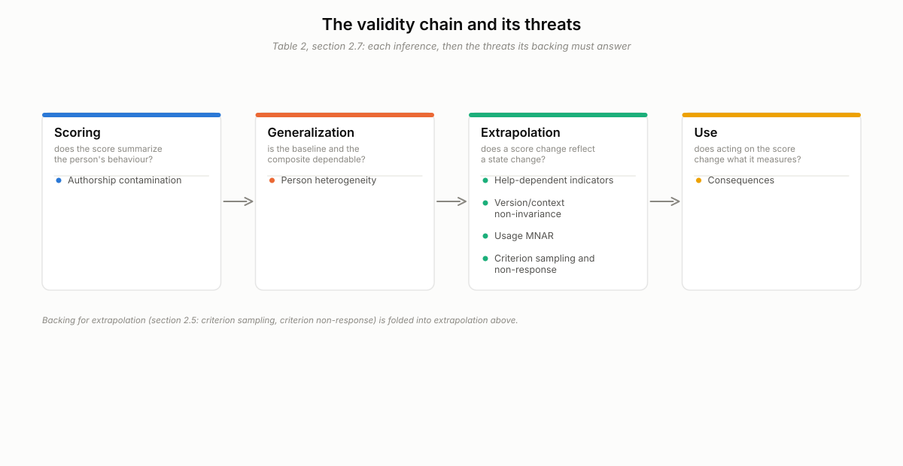
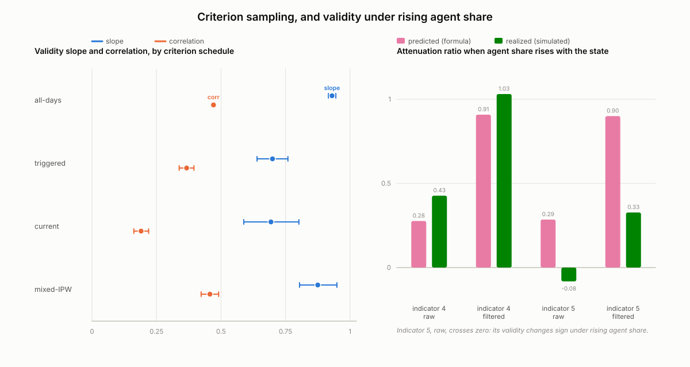
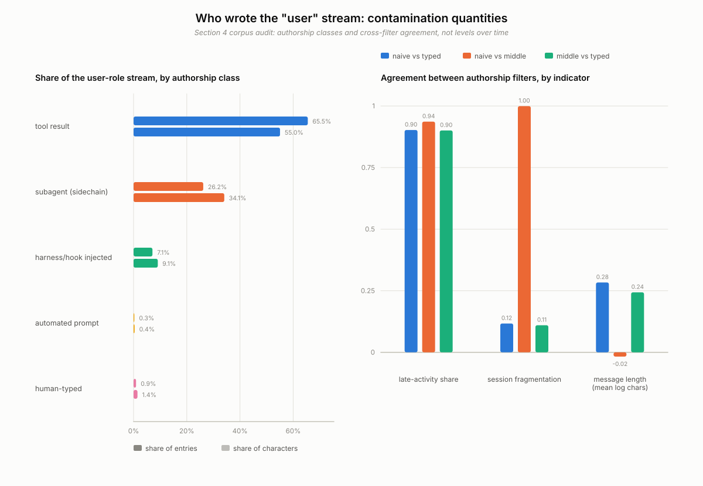

# Is it the person or the agent? Validity threats to inferring within-person change from agent conversation traces

Abhay Mettu

Manuscript draft v4, 2026-09-28. Author notes, provenance and open items are kept separately.

---

## Abstract

It is tempting to read a change in a score computed from a person's conversations with an AI agent as a
change in the person. I argue that this inference has not been validated, and I set out what validating
it would take. I lay out the interpretation as an argument-based validity argument with scoring,
generalization, extrapolation and use inferences, and place the threats specific to agents on it:
machine-authored text in the "user" stream, score-contingent agent help, silent agent and model version
changes, and criterion samples triggered by the score itself. A simulation, frozen and hashed before
scoring, tests these threats on eleven families of synthetic persons against eleven frozen predictions,
with every magnitude conditional on invented parameters. Two predictions hold. A criterion schedule
triggered by the change statistic attenuated the validity slope by 24.8 percent, about as much as
probing whenever the current score was high (25.4 percent), so it cannot be attributed to the trigger's
history. Criterion non-response tied to the state added 12 to 16 percent slope bias, short of the frozen
threshold on the interval, and weighting on observables did not remove it. When the agent-authored share
rose with the state, in a hypothetical cell, one indicator's validity changed sign (from 0.34 to -0.01).
In reporting-only metrics computed after scoring, the best rule flagged 20 percent of planted drifts
within 21 days at a high tuning target of one false flag per six tracked person-months, 3.7 times its
chance level, but the one prediction proper that passed compared it with a criterion-only rule
indistinguishable from chance. A second frozen simulation, of
a sustained shift and logged agent-behaviour changes, held one of two registered predictions; the other
failed under its frozen rule and is inconclusive under a post hoc interval reading. A metadata-only audit
of one heavy-automation user's coding-agent transcripts found that 0.93 percent of user-role entries were
typed by the person. The audit is n = 1 and descriptive. The contribution is the argument, the design
requirements it implies for a consented validation study, and an existence proof that the scoring
inference can fail badly.

---

## 1. Introduction

A person who works with a general-purpose agent leaves a long trace: what they asked for, when, how long
their messages were, how often they switched sessions, and what they left unfinished. Could that trace
register when the person's wellbeing and functioning move away from their own usual range?

The closest work uses dialogue already about mental health, as when
Tieleman et al. (2026) estimate a questionnaire-scale severity score from AI mental-health dialogue (held-out N = 842, r = .80); <!-- cite: -->
elicits answers adaptively (Varadarajan et al., 2024, 2026; Yun et al., 2024), or classifies
conversations or people cross-sectionally (Anthropic, 2025, which had no longitudinal data;
Eichstaedt et al., 2018, between persons, N = 683, AUC = 0.72). <!-- cite: -->
The OpenAI and MIT Media Lab study (2025) followed self-reported loneliness and emotional dependence
over four weeks.

None of these asks whether a within-person change in a score from ordinary agent use is a change in the
person. In phone sensing, existing models did not generalize across cohorts or years (Xu
et al., 2022), and dense experience sampling, whose within-person dynamics can carry information before
a transition (Helmich et al., 2023), rests on intensive self-report. My searches found no study
validating within-person change inferred from general-purpose assistant logs against a repeated,
independent criterion. Agent traces make the question harder: the agent writes much of the "user"
stream, its help changes what the person does next, and its software changes every few days. This paper
sets out the validity argument, tests its threats in two frozen simulations and a metadata-only audit of
my own agent transcripts, and derives requirements for a consented validation study. It builds no system
or product and makes no claim about any clinical condition.

---

## 2. The validity argument

### 2.1 Construct, interpretation and frame

**Construct.** A single latent, non-clinical state that the simulation labels wellbeing and
functioning, standardized within person and varying over days to weeks. Higher values are the direction
of concern; in the simulation a rise lowers agent use and criterion response. The change statistic is
one-sided; declines are out of scope.

**Interpretation under test.**

> A sustained rise in person i's trace-derived score above that person's own baseline indicates a rise
> in person i's state.

**Frame.** I use the argument-based approach (Kane, 2013): the interpretation is a conjunctive chain of
inferences, and backing is collected for the least plausible assumptions. Validity is a property of an
interpretation of scores (Messick, 1995; AERA, APA and NCME, 2014); Messick's construct-irrelevant
variance and construct underrepresentation organize most of what follows. Borsboom et al. (2004) hold
instead that a score is valid for an attribute only if variation in the attribute causes variation in
the score; I use that causal condition to say what the scoring inference requires, without claiming the
two views agree. Table 1 and Figure 1 (section 2.7) summarize the four inferences.

### 2.2 Scoring: whose behaviour is this?

**Inference.** An indicator computed from the user side of the transcript summarizes the person's
behaviour.

**Threat.** Much of an agent transcript's user-role stream is not typed by the user: tool results,
harness and hook injections, prompts from automated processes, subagent traffic, and pasted agent drafts.
Person-absent sessions add activity no one performed, such as a 3 a.m. automated job. Machine text is construct-irrelevant because its causal path to the indicator runs through
delegation and automation, not the behaviour the indicator is meant to reflect; when the state drives delegation, that variance is partly state-caused, so correlational
validity evidence cannot expose it.

For an indicator computed by daily averaging over entries, with a day's machine share `pi` independent
of the state and of the text values, the within-person validity is multiplied by

    Att = (1 - E pi) / sqrt(E[(1 - pi)^2] + E[pi^2] kappa + Var(pi) delta^2),

where `kappa` and `delta` are the machine-text variance ratio and mean gap in units of the human
indicator's SD (derivation in Supplement S1). With Bernoulli mixing it is the zero-coupling case of the
contamination formula for AI-written survey responses (Mettu, 2026a), and it always attenuates. If the
machine share rises with the state, the mean gap couples to the state and adds or removes validity that
belongs to the delegation.

### 2.3 Generalization: from the observed days to the person's baseline

**Inference.** The person's baseline (here, a 28-day window) and the daily composite built against it
are dependable enough that a departure from the baseline exceeds what the baseline's own sampling would
produce.

**Threats.** If the state is already changing inside the baseline, the reference is wrong. The composite
averages indicators whose number varies by day, because days without use or without a usable indicator
carry no score. And persons differ: the generator draws each person's loadings separately, but section
3's validity statistics are pooled person-centred coefficients, which can look acceptable while some
persons' scores carry little information: associations across persons license nothing about change within a
person unless strong conditions hold (Molenaar, 2004; Hamaker, 2012; Curran and Bauer, 2011; Hamaker et
al., 2015), within-person structure can diverge widely from group structure (Fisher, Medaglia and
Jeronimus, 2018), and whether a group estimate transfers to individuals has to be checked rather than
assumed (Adolf and Fried, 2019; Hamaker, 2025).

### 2.4 Extrapolation: from a change in score to a change in the state

**Inference.** A sustained rise in the score reflects a rise in the state, rather than a change in the
agent, in the help it gives, in the mix of work, or in whether the person used the agent.

**Threats.**

- *Agent and model version.* A version change can move an indicator's mean and loading; a logged change
  can be re-baselined, an unlogged one looks like drift.
- *Help.* Help changes the person's next behaviour. In an earlier simulation in this program (Mettu,
  2026b, Study 1a), personalized help raised internal consistency and fit while validity
  fell (in closed form; the simulation grid showed only a small fall), and a world with no person signal
  passed internal consistency, fit and convergent checks: reliability evidence cannot stand in for
  validity evidence (see also Shen and Han, 2026).
- *Context and non-state change.* A shifting mix of work, workload spikes, vacations, disengagement and
  broken logging can each move the score with no change in state.
- *Usage missingness.* If use depends on the state, unused days are missing not at random (Rubin,
  1976), and no analysis of used days alone removes the bias; it also weakens generalization (section
  2.3). Abstention trades coverage for protection.
- *Construct underrepresentation.* An agent trace samples only agent-mediated behaviour; change elsewhere
  in a person's life is invisible to every rule here.

### 2.5 Backing for extrapolation: how the criterion is sampled

How the criterion is sampled, and who answers it, threaten the backing for extrapolation rather than
forming inferences of their own.

**Criterion sampling.** If which days get a criterion depends on the score, the estimated validity is
biased: selection on a variable related to the predictor changes the observed correlation (Pearson,
1903; Lawley, 1944; Thorndike, 1949; Sackett and Yang, 2000; Lamp and MacKinnon, 2024). The closest
structure is verification bias, corrected by inverse-probability weighting (Begg and Greenes, 1983; Zhou
et al., 2002; Tao et al., 2021), and in experience sampling, trigger design changes which contexts get
sampled (Lathia et al., 2013). A schedule that asks for the criterion when a change statistic is high
selects on the score, on its current value as well as its history when the statistic includes the day's
score (section 3.4); a trigger on the previous day's statistic would select on history only. Weighting
needs a random floor with every occasion's selection probability logged;
a trigger-only or fixed schedule gives some days zero probability of a criterion.

**Criterion non-response.** If the person answers less often when the state is higher, answered
occasions are missing not at random, and a response model built from observables cannot fully correct
it when response depends on the state beyond what the observables carry.

### 2.6 Use: the agent acting on the score

**Inference.** Acting on the score (changing how the agent helps, or asking for a criterion) does not
change the quantities the score is meant to reflect, or the change is known.

**Threat.** Score-contingent agent behaviour feeds back into the trace: when help is targeted on the
previous day's score, as in two of the simulation's cells, later indicators depend on earlier scores, and the scoring and extrapolation
inferences are evaluated on data the rule itself shaped. A flag or a criterion prompt could also change
behaviour; the simulation fixes that reactivity at zero and says nothing about it.

### 2.7 Summary

**Table 1. Inferences, threats and backing.** R1 to R9 are the requirements of section 5.

| inference | main threats | backing needed | where tested here |
|---|---|---|---|
| scoring | machine-authored entries; person-absent sessions; state-driven delegation | entry-level provenance (R1) | section 4; 3.4, P6 |
| generalization | baseline error; drift inside the baseline; heterogeneity across persons | change-score reliability; person-level validity (R4, R7) | 3.4, P9; Supplement S6 |
| extrapolation | version, help and context non-invariance; non-state change; usage missing not at random; construct underrepresentation | invariance across versions and help; false flags by non-state family; abstention (R2 to R4) | 3.4, P7; Table S1, P1 to P3, P10; 3.7, H3 |
| backing for extrapolation | score-triggered criterion sampling; criterion non-response | random floor with logged propensities (R5) | 3.4, P4, P5 |
| use | score-contingent help; reactivity to flags and prompts | logged randomized help and prompts (R2) | targeted-help cells; Table S1, P2 |

*Figure 1.* The validity argument as a chain of scoring, generalization, extrapolation and use, with the threats placed on each. The backing for extrapolation, criterion
sampling and criterion non-response, is drawn inside extrapolation.

---

## Disclosures

**Preregistration.** Neither simulation was lodged with a registry. Each was frozen as a document in the
supplementary repository, committed and hashed before scoring: `sim/PREREG.md` for sections 3.1 to 3.5
(sha256 in section 3.1) and `sim/PREREG-003.md` for sections 3.6 and 3.7 (sha256 in section 3.6). A local
commit is not an external registration. The exploratory analyses of section 3.5 follow plans committed and
hashed before they ran (two cells of the robustness grid were computed once before its plan's commit);
post-freeze changes are disclosed in sections 3.3, 3.5 and 3.6. [author to confirm: the
corpus audit of section 4 had no preregistration]

**Data, materials and code.** The simulation code, both frozen documents, both scoring runs, the spec 003
evaluation output and dated post-evaluation amendment (`sim/PREREG-003.md`, `sim/results_003.json`,
`sim/POST-EVALUATION-003.md`), the reporting-only metrics, the audit code and the corpus audit's aggregate
outputs are in the supplementary repository. None is yet at a persistent public
archive: the author has not yet authorised a deposit. [persistent link: to be added on deposit] The transcript
corpus itself is not shared, because it contains third-party content.

**Simulation reporting.** Sections 3.2 and 3.6 and Supplement S2 and S10 give each generator and its
parameters, all invented except indicator 4's mixing parameters. The simulations have 1,000 and 4,000
persons per cell and 2,000 and 1,000 person-bootstrap draws, with seeds derived from each frozen file's
hash; the code and every frozen file's hash are in the repository.

**Ethics.** The data in section 3 are synthetic. Section 4 audits the author's own agent transcripts; no
participants were recruited. Only metadata and aggregates were stored, and no state of any person was
estimated. The stream contains some
third-party content (0.77 percent of tool results came from tools named for messaging, calendar or email).
The audit code parses user-role text and walks tool-result content in memory to count characters and assign authorship classes; it does not establish whose words every payload contains, so no claim is made that no other person's content was read. [AUTHOR TO CONFIRM: no ethics review was sought, because the only human data are the author's own
usage metadata; third-party traffic was counted by tool name, and the parse does not establish whose words each payload contains.]

---

## 3. Simulations, frozen and hashed before scoring

### 3.1 Status

The first simulation's design, metrics and predictions were frozen before scoring as a committed file
with sha256 `60db6dd195942387e5572a640224c4cb13836f29c37c1b611b14c70598678f17` (`sim/PREREG.md`), at
21:21 CDT on 2026-09-27. Written for a change-detection
layer, the design was recorded as a measurement-validity study seven minutes after the freeze, a
reframing that changed nothing in the frozen text.

### 3.2 Design

Each synthetic person has 140 days, days 1 to 28 being baseline.
The state `D_t` is AR(1) with `phi_D = 0.7` and marginal SD 1; drift families add a ramp of +1.0 SD from
an onset in days 50 to 100. Six indicators, among them message length (indicator 4) and negative
self-reference (indicator 5), load on `D` with per-person loadings and are also moved by workload,
context, logged help and agent version; indicators 4 and 5 are mixed with machine text by daily
averaging, indicator 4 at the corpus audit's entry-level values, which imply more attenuation than the
day-level values matching the generator's daily averaging (formula factor 0.235 against 0.527; Supplement
S7). The criterion `Y_t = D_t + e_Y` has reliability
0.7, and the probability of answering falls with `D` at rate `m1`. Besides stable (S) and drifting (DR)
persons, the eleven families include a drift beginning inside the baseline (BD) and non-state changes;
one-at-a-time cells vary non-response, targeted help and a hypothetical
machine share that rises with `D` (Supplement S2).

Every candidate rule runs a one-sided CUSUM (Page, 1954) on a daily composite of within-person z-scores,
tuned on family S to one false flag per six tracked person-months. `A-naive` uses every indicator on every used day; `A-fixed` adds (i) friction indicators
scored on unhelped days only (Mettu, 2026b, Study 5), (ii) indicators 4 and 5 from text an authorship
filter labels human, (iii) workload residualization, (iv) re-baselining at a logged version change and
(v) abstention when usage falls; `probe-only` uses criterion answers alone. Criterion-sampling designs
include `random`, `triggered` (probing when the CUSUM is high but below its threshold), `mixed` (a random
floor plus the trigger) and `current`, a construction check that probes when the day's composite is
high; weighting is identified only for `random` and `mixed` (Supplement S3).

### 3.3 Decision rule and scoring runs

A prediction holds only if its 95 percent Monte Carlo interval, from a 2,000-draw person bootstrap, lies
beyond its frozen threshold (or, for a "within X" clause, inside plus or minus X); nothing is re-tuned
after scoring. P1, P1b, P2 and P3 are construction checks of `A-fixed`'s components, not findings. An
audit of the scoring code against the frozen text, run by an AI agent within the same project, found
that run 1 decided every prediction on point estimates and departed from the frozen text in P1b, P4, P5
and P8. Run 2, committed 43 minutes after the freeze, applies only those fixes and is reported here; run
1 is kept, superseded (Supplement S4). The P8 fix required re-running the frozen tuning procedure for the
criterion-only rule on the tuning seed, which moved its threshold `h` from 6.539 to 22.949; no
evaluation-seed number was used. The frozen text's standard-error formula divides by the square root of
200, a leftover from an earlier design; the literal reading would change neither verdict that holds
(Supplement S3). Every verdict the fixes changed went from PASS to FAIL (P6 and
P10). Where the frozen text allows two readings, the as-run reading, fixed before scoring, decides.

### 3.4 Results

Only P1b and P8 hold. The other nine fail, including three of the four construction checks, and every
alternative reading gives the same verdict (Table S1, Supplement S5). Six failures are of precision, an
interval straddling its threshold or too wide for its band; P1 and P7 are clear misses, and P9 went the
opposite way. The directions of the selection, non-response and contamination results follow from the generator's
structure (section 3.5 qualifies them); the magnitudes are set by invented values.

**Criterion sampling (P4)** (Figure 2, left). The triggered schedule attenuated the slope of criterion
on composite by 24.8 percent [18.5, 31.3] and deflated the correlation by 0.104 [0.076, 0.133]. The
`current` control, which selects on the current score alone, attenuated the slope by 25.4 percent [14.1,
36.7], so the 24.8 percent should not be attributed to the trigger's history. The correlation deflation
is the classical range-restriction result (section 2.5); the slope attenuation is not, since direct selection on the predictor leaves the slope unbiased in a homogeneous
linear-Gaussian model; here it plausibly combines selection with per-person loadings, scaling and
person-centring (Supplement S7). With the previous day's statistic in the trigger, the alternative
reading and the more natural one for a real study, given equal weight, the attenuation was 16.1 percent
[10.0, 22.1]. The history-conditional weighting of micro-randomized trials (Boruvka et
al., 2018) applies, but at 1,000 persons its interval, about 0.14 wide, cannot fit a band 0.06 wide, so
the frozen design could not have shown weighted recovery under either reading.

**Criterion non-response (P5).** At `m1 = 1.5`, state-dependent non-response added 12.2 to 15.5 percent
slope bias across the four schedules, short of the frozen 10 percent threshold on the interval (lower
bounds 5.3 to 7.0). A response-propensity weight on the current and lagged composite and day of week did
not remove it, in a generator where response depends on the state by construction.

**Authorship (P6).** The contamination formula tracks the simulated attenuation in expectation (largest
point difference 0.023), though three of six comparisons fall outside plus or minus 0.03 on the
interval. In the hypothetical rising-share cell (Figure 2, right), message length's attenuation factor
exceeded the formula by 0.151 [0.119, 0.192], validity supplied by delegation rather than by behaviour.
For negative self-reference, whose machine-text mean sits below the human mean, within-person validity
changed sign, from 0.340 [0.334, 0.346] unmixed to -0.011 [-0.016, -0.005]; filtering restored the sign but not the size (0.138 [0.131, 0.146]). This is not a frozen
prediction, since P6's rising-share clause names indicator 4 only, and it follows from an invented
machine-text mean (-1.0 SD) and coupling slope (0.5).

**Drift inside the baseline (P9).** BD was flagged more often in days 29 to 49 (0.272) than DR within 21
days of onset (0.197), the opposite of the prediction; a candidate explanation is unchecked (Supplement
S7).

**Sensitivity and P8.** In frozen reporting-only metrics, computed after scoring with no threshold
(Supplement S6), A-fixed flagged 0.197 of DR persons within 21 days of onset, 3.7 times its chance level
of 0.053 [0.039, 0.067], at a tuning target of one false flag per six tracked person-months that is high
for any setting in which a flag would reach a person. P8, a frozen prediction, held by 17.8 points [15.2, 20.4] over the criterion-only rule, but by the same
reporting-only metrics that comparator was indistinguishable from chance (0.019 [0.011, 0.028] against 0.015 [0.008, 0.023]), and its false-flag
matching held per tracked person-month (0.179 against 0.151) but not per total person-month (0.014
against 0.121): a property of the frozen four-probe scaling, not evidence that passive scoring beats
asking.

*Figure 2.* Left: person-centred slope and correlation of criterion on composite (family S), on all
days and on days sampled by the triggered, `current` and weighted mixed schedules, with 95 percent
intervals. Right: attenuation factor predicted by the formula and simulated when the
agent-written share rises with the state (hypothetical cell), for indicators 4 and 5, raw and filtered;
indicator 5 raw is simulated at -0.08 against a predicted 0.29. The -0.08 is a mean of per-person
attenuation ratios; the -0.011 in the text is a different estimator, the person-averaged within-person
correlation of the indicator with the state.

### 3.5 Exploratory analyses (not frozen)

A robustness grid of 11 cells, under a plan hashed before the run (`sim/ROBUSTNESS-PLAN.md`; two cells
were computed once before its commit), changes no verdict in Table S1. Under the plan's own rule, three
of its six expectations held in every cell and three failed in named cells, though every direction held
on point estimates (Supplement S8). A-fixed's
component (ii) scores indicators 4 and 5 from the authorship-filtered text, but the per-person baseline
mean and standard deviation that those two indicators are standardized against were fit on the
unfiltered text in every run above, a mismatch found after scoring. A sensitivity analysis hashed before
it ran (`sim/SENS-BASELINE-PLAN.md`), with a matched baseline and
thresholds re-tuned by the frozen procedure, changed none of the 14 primary verdicts; keeping the frozen thresholds instead changes five verdicts,
which the plan's reading rule classes as an operating-point effect. Sensitivity fell
from 0.197 to 0.176, with no paired interval, so the drop is not established. The as-run baseline is a
disclosed choice, not a fix, and the matched baseline is the one a future scorer should use (Supplement
S9).

### 3.6 Spec 003: a sustained shift and logged observer changes

Spec 003 keeps the generator and A-fixed, with help off and a 210-day record. In families DR-1.0 and
DR-1.5, `D` ramps up by 1.0 or 1.5 SD and stays there. An alarm (a flag) is confirmed if three spaced
probes average at least 0.5 above four baseline probes; H2a compares this with the same rule against an
oracle reference free of baseline error, available only in simulation. In the PS families the agent's own behaviour changes, logged for half of persons.
Rule L0 ignores the log; L1 resets the statistic, holds it and re-baselines every indicator over 14 days;
L2 re-baselines only the logged indicators (Supplement S10).

Two registered predictions (H2a, H3) and four construction checks were frozen in `sim/PREREG-003.md` at
12:27 CDT on 2026-10-07, sha256 `06ee47576d02bc440560115b07aad029e8c7574480b684b4c7779d796c99bb79`, and
scored once (attested by the run log; the frozen scorer did not enforce it) at N = 4,000 persons per
cell. Choices
made after the design run are disclosed there (Supplement S10), among them H3's point rule for L1 and L2,
chosen knowing it passed on the design draw (1.421) where the interval rule did not ([1.175, 1.706]),
while the only other draw gave 1.629, above 1.5.

A blocking design review by a separate AI agent was complete at 10:44 CDT, before the freeze, but the
freezing lane (the agent session that froze the file) had not read it, and its blocking items, among them
an objection to H3's point rule, were not applied. A dated amendment written after the evaluation
(`sim/POST-EVALUATION-003.md`) discloses the review and adds post hoc readings and nine definition
corrections; it changes no frozen verdict, threshold or number.

### 3.7 Results, spec 003: a sustained shift in `D`

Under the frozen rules, one of the two registered predictions holds and H3 fails, on one of its six
clauses. H2a holds: on stable
persons at `phi_D` 0.9, spaced probes confirmed a share of first post-baseline alarms 0.202 [0.175,
0.227] higher against the four-probe baseline than against the oracle reference (threshold 0.10). All four construction checks held. H3 predicted that, for persons whose observer change was logged, the
alarm rate after the change, over the same persons' rate on the stable panel, would stay below 1.5 under
L1 and L2 and exceed 1.5 under L0, in families PS-sub and PS-use. Supplement S11 gives Table S2, the
probe budget and exploratory comparisons.

**Registered prediction H3. [author wording]** Under its frozen rule, H3 did not hold. That rule read L1 and L2 on
the point estimate and L0 on the interval, and H3 failed on one of its six clauses: L1 on PS-sub had a point
estimate of 1.576 [1.421, 1.749] against "below 1.5". The other five clauses met the frozen rule (Table S2).
The frozen file states that a pass on the point is weaker than a pass on the interval; L1 on PS-use met the rule
on the point only, and its interval contains 1.5. The pre-freeze review of section 3.6 objected to the point rule. In its synthetic,
design-stage Monte Carlo (500 populations per sample size), the generator's PS-sub L1 ratio was about 1.585, above
1.5, and the design draw on which the rule had been chosen sat at its 16th percentile, so a pass on the point
would have been sampling noise. These Monte Carlo figures come from the review document (`REVIEW.md`, sha256
`35adb9077bbc4fdc2e117c3f8861cdb23619f30a4f1fc8911f47a37c010accd4`), which is outside the supplementary
repository; `sim/POST-EVALUATION-003.md` sections (c) and (d) mirror them. It recommended reading every clause on
its 95 percent interval, with a three-way outcome: holds, fails or inconclusive. Read that way after the
evaluation, and labelled post hoc, both L1 clauses are inconclusive, because each interval contains 1.5; L2 holds
on both families (upper bounds 1.309 and 1.286), as does L0; and H3 as a whole is inconclusive. On this reading,
neither L1 point estimate is read as a pass or a fail. This was the review's expected outcome: at N 4000 its Monte
Carlo had PS-sub's L1 clause inconclusive on the interval in 0.792 of populations, and the frozen rule passing H3
in only 0.148, so the frozen FAIL is the generator's usual outcome, not bad luck. That Monte Carlo describes the
generator; it is neither confirmatory power nor evidence about the evaluation draw. An unregistered comparison
arm, L1_step (Supplement S11), was not sized or registered for H3 and is reported as a comparison, not a rescue:
under the frozen rule H3 stands as failed.

---

## 4. A one-person corpus audit of the scoring inference

### 4.1 Methods

**Data and scope.** The corpus is my own transcripts from one coding-agent command-line tool, read only.
I am a heavy user of automation, so the corpus is not a sample of everyday agent conversations.
Aggregates use the 73,955 user-role entries timestamped on or before a snapshot cutoff
(2026-09-28T01:32:31Z), reproducible from any later state of the corpus.

**What is kept.** Per-entry metadata and an authorship class. Tool-result payloads are walked in memory only to count characters and are not stored or classified; other text is
used only in memory, to classify and check for pastes.

**Authorship and indicators.** Each entry gets one authorship class (table below), mostly from structural
markers; native provenance fields cover under 5 percent of user entries. Late-activity share,
session fragmentation and message length are computed naive (all user-role entries), middle (without
tool results and subagent traffic) and typed (`human-typed` only). Only the disagreement between versions
is reported, never the level of a typed series, the nearest thing here to a behavioural signal about the
person (Supplement S12).

### 4.2 Results

**Who wrote the "user" stream.**

| class | share of entries | share of characters |
|---|---:|---:|
| tool-result | 0.655 | 0.550 |
| sidechain | 0.262 | 0.341 |
| injected | 0.071 | 0.091 |
| lane-prompt | 0.003 | 0.004 |
| human-typed | 0.0093 | 0.0144 |
| human+paste | 0.000 | 0.000 |

Of 73,955 user-role entries, 688 were classed as typed (Figure 3). Main-thread machine text is harness injection and automated
prompts, not delegated drafts; its day-mean share (0.845), entry-level gap
(0.274) and variance ratio (0.547) are indicator 4's simulation parameters; its day-level gap and ratio,
0.196 and 0.098, match the generator's daily averaging and imply less attenuation (section 3.2). Of 1,544 main sessions, 1,303
(0.844) had no typed entry; they supplied 0.570 of all naive entries and 0.750 of those between 00:00
and 05:00.

**Naive, middle and typed.** Correlations between versions of the same daily indicator (24 days for
naive against middle, 21 days with typed entries otherwise):

| indicator | naive vs typed | naive vs middle | middle vs typed |
|---|---:|---:|---:|
| late-activity share | 0.90 | 0.94 | 0.90 |
| session fragmentation | 0.12 | 1.00 | 0.11 |
| message length (mean log chars) | 0.28 | -0.02 | 0.24 |

*Figure 3.* Corpus audit, contamination quantities only. Left: share of the 73,955 user-role entries,
and of their characters, by authorship class. Right: correlations between the naive, middle and typed
daily versions of three indicators.

Fragmentation contamination comes from injected and automated-prompt traffic: the middle series is almost
the naive one and nearly unrelated to the typed one. Message length is broken twice, by tool-result and
subagent traffic and again by injection. Late activity agreed best even though three quarters of its naive
entries came from autonomous sessions, so that agreement is a property of this window.

**Change points.** All 8 change points in the training period (the first 70 percent of days with a
typed entry; Supplement S12) fell within 3 days of an independently
dated infrastructure event, which is uninformative: every calendar day in the range has such an event
within 3 days, so every change in a trace-derived series has a plausible infrastructure explanation.

### 4.3 Limitations of the audit

The audit is n = 1 and descriptive: one person's corpus from one tool, and that person also wrote the
audit, the automated processes behind most of the machine text, and the harness configuration. It is an
existence proof and a measurement protocol, not an estimate for any population. An automated process
whose prompt was never stored is classed as typed, so the typed share is an upper bound on that account;
the corpus covers 24 active days, and no state or label was estimated.

---

## 5. What a validation study would need

These requirements, which follow from sections 2 to 4, describe a future study with consenting
participants.

- **R1.** Entry-level authorship provenance, including person-absent sessions (section 4).
- **R2.** Help logged and randomized at a constant probability (Klasnja et al., 2015; Nahum-Shani et al.,
  2018), with friction indicators scored on unhelped days.
- **R3.** Logged, dated agent and model versions.
- **R4.** A baseline and abstention policy fixed before data and reported with its coverage cost.
- **R5.** A random criterion floor with logged propensities, powered for the weighted estimate, using an
  independent, validated self-report or clinician rating whose non-response is modelled.
- **R6.** Months of retained history per person, including a clean baseline.
- **R7.** Within-person designs with person-level reporting (Curran and Bauer, 2011; Hamaker et al., 2015).
- **R8.** A criterion-only comparator scaled on enough baseline answers to have non-trivial sensitivity.
- **R9.** Consent to the specific data surfaces, retention period and criterion schedule, with other
  people's content excluded or separately cleared. It has been proposed that inferences about mental state
  be governed the same way whatever their source (Horiuchi, 2026). Any feedback to participants falls
  under section 7.

---

## 6. Limitations and scope

The simulated state `D` is a single, non-clinical wellbeing and functioning variable. Nothing in the
simulation maps to any clinical condition, and no condition is a target or a result anywhere in this
work. Every generator parameter except indicator 4's mixing parameters (one person, entry level) is
invented, and every magnitude is conditional on them. Help never changes `D`, so nothing here bears on
whether an agent's intervening helps or harms anyone; the criterion is valid by construction. Supplement
S13 lists the remaining limits.

---

## 7. Translational note

**Translational paragraph (the only one in this paper).** If a future consented study established the
argument in section 2, the method could inform research on wellness-oriented tools that track trends and
baselines over time, looking for within-person change from a person's own baseline in behavioural
patterns. Such a tool may help people notice changes worth discussing with a professional. When the
patterns it tracks move outside their usual range, it could let the person know that talking with a
healthcare professional might be helpful,
without naming any condition, labeling the change as abnormal, or recommending any treatment.
**This is a measurement method, not a diagnostic instrument. Score changes are screening-level signals.
No clinical inference about any individual should be drawn without professional assessment.** The
regulatory line between general wellness software and a regulated device is drawn by intended use as
stated in claims (FDA, 2026), and nothing in this paper states an intended use.

---

## Author contributions and conflicts

[DRAFT declarations, pending the author's confirmation]

**Author.** Abhay Mettu, sole author; independent researcher. [ORCID 0009-0001-2434-353X, public record checked
2026-10-07; author to confirm use]

**Contributions.** Sole author. [author to confirm contribution roles, if the venue asks for a taxonomy]

**Funding.** No external funding.

**Conflicts of interest.** No competing interests.

**Use of AI tools.** The simulation code, the corpus-audit code, the analyses, the audit of the scoring
code against the frozen text, and this draft were produced with AI coding agents (Anthropic Claude
models) working under the author's direction.
Candidate minimal line: "Claude assisted with code development and manuscript preparation." The venue asks the
statement to name the model, its purpose, what the author checked and its limits: [model and version: author to
specify]; [purpose: author to specify]; [what the author checked: author to specify]; [limits: author to
specify].

---

## References

- Adolf, J. K., and Fried, E. I. (2019). Ergodicity is sufficient but not necessary for group-to-individual generalizability. *Proceedings of the National Academy of Sciences*, 116(14), 6540-6541.
- AERA, APA and NCME (2014). *Standards for Educational and Psychological Testing.* American Educational Research Association.
- Anthropic (2025, June 27). How people use Claude for support, advice, and companionship. Anthropic research report.
- Begg, C. B., and Greenes, R. A. (1983). Assessment of diagnostic tests when disease verification is subject to selection bias. *Biometrics*, 39(1), 207-215. <!-- cite: -->
- Bolger, N., and Laurenceau, J.-P. (2013). *Intensive Longitudinal Methods: An Introduction to Diary and Experience Sampling Research.* Guilford Press.
- Borsboom, D., Mellenbergh, G. J., and van Heerden, J. (2004). The concept of validity. *Psychological Review*, 111(4), 1061-1071.
- Boruvka, A., Almirall, D., Witkiewitz, K., and Murphy, S. A. (2018). Assessing time-varying causal effect moderation in mobile health. *Journal of the American Statistical Association*, 113(523), 1112-1121.
- Curran, P. J., and Bauer, D. J. (2011). The disaggregation of within-person and between-person effects in longitudinal models of change. *Annual Review of Psychology*, 62, 583-619.
- Eichstaedt et al. (2018). Facebook language predicts depression in medical records. *Proceedings of the National Academy of Sciences*, 115(44), 11203-11208. doi:10.1073/pnas.1802331115. <!-- cite: -->
- FDA/CDRH (2026, January 6). *General Wellness: Policy for Low Risk Devices.* Guidance for Industry and Food and Drug Administration Staff.
- Fisher, A. J., Medaglia, J. D., and Jeronimus, B. F. (2018). Lack of group-to-individual generalizability is a threat to human subjects research. *Proceedings of the National Academy of Sciences*, 115(27), E6106-E6115.
- Hamaker, E. L. (2012). Why researchers should think "within-person": A paradigmatic rationale. In M. R. Mehl and T. S. Conner (Eds.), *Handbook of Research Methods for Studying Daily Life.* Guilford Press.
- Hamaker, E. L. (2025). Analysis of intensive longitudinal data: Putting psychological processes in perspective. *Annual Review of Clinical Psychology*, 21, 379-405.
- Hamaker, E. L., Kuiper, R. M., and Grasman, R. P. P. P. (2015). A critique of the cross-lagged panel model. *Psychological Methods*, 20(1), 102-116.
- Helmich, Smit, Bringmann, Schreuder, Oldehinkel, Wichers, and Snippe (2023). Detecting impending symptom transitions using early-warning signals in individuals receiving treatment for depression. *Clinical Psychological Science*, 11(6), 994-1010. doi:10.1177/21677026221137006. <!-- cite: -->
- Horiuchi, S. (2026). Governing mental-state inference: Source-neutral regulatory triggers and tiered obligations. arXiv:2608.00936.
- Kane, M. T. (2013). Validating the interpretations and uses of test scores. *Journal of Educational Measurement*, 50(1), 1-73.
- Klasnja, P., Hekler, E. B., Shiffman, S., Boruvka, A., Almirall, D., Tewari, A., and Murphy, S. A. (2015). Microrandomized trials: An experimental design for developing just-in-time adaptive interventions. *Health Psychology*, 34(Suppl), 1220-1228.
- Lamp, S. J., and MacKinnon, D. P. (2024). Correcting regression coefficients for collider bias in psychological research. *Multivariate Behavioral Research*, 59(3), 647-648.
- Lathia, N., Rachuri, K. K., Mascolo, C., and Rentfrow, P. J. (2013). Contextual dissonance: Design bias in sensor-based experience sampling methods. *Proceedings of UbiComp '13*, 183-192.
- Lawley, D. N. (1944). A note on Karl Pearson's selection formulae. *Proceedings of the Royal Society of Edinburgh, Section A*, 62(1), 28-30.
- Messick, S. (1995). Validity of psychological assessment: Validation of inferences from persons' responses and performances as scientific inquiry into score meaning. *American Psychologist*, 50(9), 741-749.
- Mettu, A. (2026a). Ghost respondents: A boundary map for covert AI authorship in open-ended survey data. Unpublished working paper.
- Mettu, A. (2026b). agentSEM simulation studies 1a (helpful-agent trap), 2 (ask-versus-infer budget rules) and 5 (task friction under randomized help). Unpublished simulation reports.
- Molenaar, P. C. M. (2004). A manifesto on psychology as idiographic science: Bringing the person back into scientific psychology, this time forever. *Measurement: Interdisciplinary Research and Perspectives*, 2(4), 201-218.
- Nahum-Shani, I., Smith, S. N., Spring, B. J., Collins, L. M., Witkiewitz, K., Tewari, A., and Murphy, S. A. (2018). Just-in-time adaptive interventions (JITAIs) in mobile health: Key components and design principles for ongoing health behavior support. *Annals of Behavioral Medicine*, 52(6), 446-462.
- OpenAI and MIT Media Lab (2025). Investigating affective use and emotional well-being on ChatGPT. arXiv:2504.03888.
- Page, E. S. (1954). Continuous inspection schemes. *Biometrika*, 41(1-2), 100-115.
- Pearson, K. (1903). Mathematical contributions to the theory of evolution. XI. On the influence of natural selection on the variability and correlation of organs. *Philosophical Transactions of the Royal Society of London, Series A*, 200, 1-66.
- Rubin, D. B. (1976). Inference and missing data. *Biometrika*, 63(3), 581-592.
- Sackett, P. R., and Yang, H. (2000). Correction for range restriction: An expanded typology. *Journal of Applied Psychology*, 85(1), 112-118.
- Shen and Han (2026). The reliability illusion in synthetic patients: Psychometric misalignment of open-weight LLMs on PHQ-9 and GAD-7. *Proceedings of CLPsych 2026.*
- Tao, R., Mercaldo, N. D., Haneuse, S., Maronge, J. M., Rathouz, P. J., Heagerty, P. J., and Schildcrout, J. S. (2021). Two-wave two-phase outcome-dependent sampling designs, with applications to longitudinal binary data. *Statistics in Medicine*, 40(8), 1863-1876.
- Thorndike, R. L. (1949). *Personnel Selection: Test and Measurement Techniques.* Wiley.
- Tieleman, O., Zhu, Z., Su, T., Bell, S. J., Hull, T. D., and Stamatis, C. A. (2026). Fine-tuning LLMs for passive depression severity estimation from AI mental health dialogue. arXiv:2606.17973. <!-- cite: -->
- Varadarajan, V., Sikström, S., Kjell, O., and Schwartz, H. A. (2024). ALBA: Adaptive language-based assessments for mental health. *Proceedings of NAACL 2024.*
- Varadarajan, V., Xu, H., Boehme, R. A., Mirstrom, M. M., Sikström, S., and Schwartz, H. A. (2026). MAQuA: Multi-outcome adaptive question-asking for mental health using item response theory. *Proceedings of EACL 2026.*
- Xu et al. (2022). GLOBEM: multi-year, multi-site passive-sensing and wellbeing dataset and cross-dataset generalization benchmark. *IMWUT / UbiComp 2023.* doi:10.1145/3569485.
- Yun, H. S., Arjmand, M., Sherlock, P., Paasche-Orlow, M. K., Griffith, J. W., and Bickmore, T. (2024). Keeping users engaged during repeated interviews by a virtual agent: Using large language models to reliably diversify questions. *Proceedings of ACM IVA 2024.* arXiv:2311.12707.
- Zhou, H., Weaver, M. A., Qin, J., Longnecker, M. P., and Wang, M. C. (2002). A semiparametric empirical likelihood method for data from an outcome-dependent sampling scheme with a continuous outcome. *Biometrics*, 58(2), 413-421.
